# Governance 架构审计 — 为 OpenCode + DeepSeek Agent 集成做准备

Date: 2026-10-29
Scope: read-only audit of `H:/Projects/Governance` at the code level
Method: 逐文件阅读 `src/`、`web/`、`package.json`、配置文件；结论均附代码位置；无法由代码证明的标为 **待验证**

> 审计口径：不依据依赖包推断能力，不依据文件名推断职责，不依据 README 采信实现。
> 下文每条结论都指向真实调用点。

---

## 0. 结论摘要（先读这一段）

**这个项目不是"待接入 Agent 的空壳"。它已经有一个可用的 OpenCode 适配器、一个 Agent 执行 seam、一个 Anthropic 形态的 API transport、以及一整套阶段派生与门禁规则。**

真正的缺口不在适配器，而在**控制面**：

| # | 缺口 | 现状证据 | 影响 |
|---|---|---|---|
| 1 | **没有任何 HTTP 端点能触发阶段执行** | `src/server/http.ts` 全部路由中无 run 类端点；`advance` 只在 CLI 内 | Web UI 无法调度 Agent，只能读 |
| 2 | **UI 的 "advance" 是一个假按钮** | `web/index.html:2744` → `case 'advance':toast(...)`，无 fetch | 点击只弹提示，服务端无感知 |
| 3 | **门禁定义没有写入路径** | `gates.json` 仅被 `discover.ts:99` 读取，全仓无写入者 | 新建 effort 默认零门禁，门禁形同未启用 |
| 4 | **决策记录不回显到看板** | 前端从不调用 `/api/gates`；`__decided` 服务端从不设置 | 记了决策，界面不变，违反"日志是唯一权威"的可用性前提 |
| 5 | **API transport 是 Anthropic 专用** | `apiagent.ts:242` 硬编码 `/v1/messages` + `x-api-key` | DeepSeek 无法走 `transport=api`，只有 OpenAI 兼容协议 |
| 6 | **CLI transport 无文件系统边界** | `adapters.ts:82` OpenCode 用 `--auto`；约束只写在 prompt 里 | Agent 能力上可写仓库任意位置；"不要写到外面"是请求，不是限制 |

所以本次集成的工程量，主要不是"写 adapter"，而是"给已有的执行能力加一个受治理的调用入口"。

> **实施进度（2026-10-30）**：#1 已在 P2 关闭（四个 run 端点 + `JobRegistry`，见 §12）；#2 待 P4 接线；#3 已有决策与语义（§9），严格校验器待实现；#4 已在 P4 关闭（见 §14）；#5 不影响当前路线（DeepSeek 由 OpenCode 自管，不走 `transport=api`）；#6 已在 P3 部分关闭（路径边界预防 + 哈希与 git 检测，无沙箱，见 §13.3）。
>
> **集成主线已闭环（2026-10-30）**：P0→P5 全部完成（§10–§16），真实 DeepSeek 会话端到端验证通过。P6（§17）完成四项增强收尾：轮号重锚（真缺陷修复）、gates.json 严格校验器、多 effort UI 切换、真实 401 形状取证与分类修复。§16.4 遗留观察全部解决，无已知阻塞项。

---

## 1. 当前架构图

只画代码能证明的组件与真实调用关系。

```mermaid
flowchart TB
  subgraph B["浏览器 (loopback)"]
    UI["web/index.html<br/>3784 行，渲染 + inline handlers"]
    APIJS["web/api.js<br/>domain→view 适配 + fetch 传输"]
    SJS["web/session.js<br/>会话流程状态"]
    THEME["web/theme.js<br/>主题（经典 script）"]
  end

  subgraph N["单一 Node 进程 — node dist/src/cli.js serve"]
    CLI["src/cli.ts<br/>scan / serve / advance"]
    HTTP["src/server/http.ts<br/>http.createServer + 静态文件"]
    WS["src/workspaces.ts<br/>roots 声明"]
    SET["src/config/settings.ts<br/>解析/校验/写回"]
    DISC["src/tracker/discover.ts<br/>扫描 + 事实收集"]
    PARSE["src/tracker/parse.ts<br/>markdown 解析"]
    DEC["src/tracker/decisions.ts<br/>append-only 决策日志"]
    SCAF["src/tracker/scaffold.ts<br/>/api/init 写骨架"]
    STG["src/domain/stages.ts<br/>纯函数：阶段派生"]
    TYP["src/domain/types.ts<br/>领域模型"]
    SESS["src/session/session.ts<br/>会话生命周期"]
    PR["src/session/prompt.ts<br/>prompt 组装"]
    RND["src/session/round.ts<br/>round 产物解析"]
    RUN["src/exec/runner.ts<br/>planAdvance / advance(仅 CLI)"]
    AG["src/exec/agent.ts<br/>spawnRunner / probeCli"]
    ADP["src/exec/adapters.ts<br/>claude / opencode argv"]
    RES["src/exec/resolve.ts<br/>Windows shim → node"]
    APIR["src/exec/apiagent.ts<br/>Messages API + 工具循环"]
    DEMO["src/exec/demo.ts<br/>脚本化 agent"]
  end

  subgraph F["本地文件系统（唯一真相）"]
    CFG["governance.settings.json<br/>governance.workspaces.json"]
    SCR[".scratch/&lt;effort&gt;/<br/>map.md · spec.md · GLOSSARY.md<br/>issues/NN-*.md · gates.json<br/>decisions.jsonl<br/>.session/ · runs/"]
    SK["~/.agents/skills/&lt;id&gt;/SKILL.md<br/>(默认硬编码路径)"]
  end

  subgraph X["外部进程 / 服务"]
    OCLI["opencode / claude CLI"]
    MCPX["MCP server (stdio|http)"]
    ANTH["Messages API /v1/messages"]
    GIT["git 可执行文件"]
  end

  UI --> APIJS
  UI --> SJS
  APIJS -->|"fetch /api/*"| HTTP
  SJS --> APIJS
  HTTP --> DISC
  HTTP --> DEC
  HTTP --> SCAF
  HTTP --> SESS
  HTTP --> SET
  HTTP --> AG
  HTTP --> APIR
  HTTP --> DEMO
  DISC --> PARSE
  DISC --> DEC
  DISC --> STG
  STG --> TYP
  PARSE --> TYP
  SESS --> PR
  SESS --> RND
  SESS -->|"AgentRunner.run()"| AG
  CLI -->|"serve"| HTTP
  CLI -->|"advance"| RUN
  CLI -->|"scan"| DISC
  CLI --> WS
  RUN --> ADP
  RUN -->|"spawn(argv)"| OCLI
  AG --> ADP
  AG --> RES
  AG -->|"spawn(argv)"| OCLI
  HTTP -->|"/api/mcp/test spawn"| MCPX
  HTTP -->|"/api/agent/test probe"| OCLI
  APIR -->|"fetch POST"| ANTH
  DISC -->|"execFile git"| GIT
  DISC --> SCR
  DEC --> SCR
  SCAF --> SCR
  SESS --> SCR
  HTTP --> CFG
  SET --> CFG
  HTTP -->|"readFile 静态资源"| UI
  HTTP -->|"stat 存在性"| SK
  PR -->|"路径写进 prompt"| SK
```



**读图要点**

- 只有一个进程。UI 与 API 同源同端口（`http.ts:937` 绑定 `127.0.0.1`），静态文件由同一个 handler 兜底（`http.ts:908-920`）。
- 所有数据流的方向是 **markdown → 解析 → 派生 → 投影到 UI**，没有反向的"UI 状态 → 数据库"。
- Agent 是**被 spawn 的子进程**，不是被 import 的库。Governance 不执行 skill，只把 `SKILL.md` 的路径写进 prompt（`prompt.ts:56`、`runner.ts:81`），由 CLI 去读。
- 没有数据库、没有消息队列、没有定时器、没有文件监听（`http.ts:946-951` 只处理 SIGINT/SIGTERM）。
- `advance` 是唯一会真正执行阶段的路径，且它**不经过 HTTP**。

---

## 2. 架构分类

### 2.1 当前架构类型

**单进程、前后端一体的本地应用服务器（local-first modular monolith）。**

不是纯前端，也不是可分离部署的前后端：

| 证据 | 位置 |
|---|---|
| 一个 `http.createServer` 同时提供 API 与静态资源 | `src/server/http.ts:369`（`serve()`）、`:926`、`:908-920` |
| 无前端构建步骤，`web/` 是原生 ES module | `package.json:10-22` 无 bundler；`web/index.html:1063-1064` `import * as API from './api.js'` |
| 零运行时依赖 | `package.json:23-26` 仅 `typescript` + `@types/node` |
| 编译产物单入口 | `package.json:11` `tsc -p tsconfig.json`；`package.json:16` `node dist/src/cli.js serve` |

严格说它更接近 **BFF（backend-for-frontend）形状**：服务端不做业务状态机，只做"读盘 → 投影"和"追加一条日志/写一组文件"。

### 2.2 是否存在本地后端

**存在，且是唯一的后端。**

- 入口：`src/server/http.ts:369 export async function serve(options: ServeOptions)`
- 由 CLI 分派：`src/cli.ts:106-114` `case 'serve'`
- 监听：`http.ts:937 server.listen(port, '127.0.0.1')`
- 端点清单（全部在 `http.ts` 内 if 链，无 router 框架）：
  `/api/health` `:427`、`/api/projects` `:432`、`/api/gates` `:437`、`/api/decisions` `:456`、`/api/decide` `:471`、`/api/open-gates` `:526`、`/api/settings` GET/PUT `:543`/`:555`、`/api/chain` `:578`、`/api/mcp` `:602`、`/api/mcp/test` `:614`、`/api/init` `:636`、`/api/session/agent` `:691`、`/api/agent/test` `:758`、`/api/session` `:786`、`/api/session/start` `:813`、`/api/session/answer` `:837`、`/api/session/reset` `:865`、`/api/session/finalise` `:887`

**没有的**：进程管理、任务队列、run 触发、run 状态查询、取消、日志流。

### 2.3 是否能够安全执行本机 CLI

**能执行；"安全"只在一半的路径上成立。** 这是本次审计最重要的区分。

| 能力 | 是否具备 | 证据 |
|---|---|---|
| spawn 子进程 | 是 | `agent.ts:143`、`runner.ts:205`、`http.ts:347`（MCP probe）、`discover.ts:68`（`execFile git`） |
| 参数以数组传递，不过 shell | 是 | `adapters.ts:7-10` 注释与实现；`resolve.ts:15-23` 明确拒绝 `shell:true` |
| 超时终止 | 是 | `agent.ts:168-178`（kill + phase='timeout'） |
| Windows shim 解析 | 是 | `resolve.ts:58 findOnPath`、`:151 resolveCli`、`:113 entryFromShim` |
| 失败分类（非"能跑/不能跑"二分） | 是 | `agent.ts:299-359` `ProbeReason` 7 类 |
| **API transport 的写路径约束** | 是 | `apiagent.ts:112-160` `contains()` + `runTool` 拒绝越界写 |
| **CLI transport 的写路径约束** | **否** | 仅 `runner.ts:94` / `prompt.ts:60` 的 prompt 文本约束；`opencodeAdapter` 用 `--auto`（`adapters.ts:82`）自动批准所有工具 |
| 工具白名单 | 仅 Claude 生效 | `adapters.ts:50-52` Claude 传 `--allowedTools`；`opencodeAdapter.turnArgs` 完全忽略 `turn.allowedTools` |
| 操作系统级沙箱 | 否 | 无 container / job object / seccomp；`isolation: 'worktree'` 只是存储字段（`settings.ts:70`、`:506`），无实现 |

**结论**：可以执行，但当前是"**契约式隔离**"——靠 prompt 请求 Agent 守规矩，而不是靠权限拒绝。在接入一个每天要跑九个阶段的 Agent 之前，这一点必须补上（见 §5.4）。

### 2.4 项目数据的存储与访问方式

**纯文件系统，无数据库。** 这是设计，不是权宜（`docs/adr/0004`、`README.md:96-115`）。

| 数据 | 位置 | 写入者 | 读取者 |
|---|---|---|---|
| 阶段产物（PRD/地图/术语/票据） | `<repo>/.scratch/<effort>/*.md`、`issues/NN-*.md` | **Agent**（经 skill），或 `scaffold.ts:273-275` | `parse.ts` ← `discover.ts:138-256` |
| 门禁定义（不可变） | `.scratch/<effort>/gates.json` | **无写入者**（只能手写） | `discover.ts:95-111` |
| 门禁决策（只追加） | `.scratch/<effort>/decisions.jsonl` | `decisions.ts:187 appendFile` | `decisions.ts:71` |
| 会话状态（缓存） | `.scratch/<effort>/.session/state.json` | `session.ts:93-97` | `session.ts:82-91` |
| 会话轮次（记录） | `.session/NN.json`、`latest.json` | Agent（按 prompt 约定） | `round.ts:204 readRound` |
| 阶段运行日志 | `.scratch/<effort>/runs/<ts>-<stage>.log` | `runner.ts:228` | **无人读取**（README 自述 "not read yet"） |
| API 会话历史 | `.session/api-history/<key>.json` | `apiagent.ts:185` | `apiagent.ts:173` |
| 全局配置 | 包根 `governance.settings.json` / `governance.workspaces.json` | `settings.ts:569 writeSettings`；手写 | `settings.ts:549`、`workspaces.ts:46` |

关键性质：**Governance 从不拥有状态，只读它**。`http.ts:422` 每个请求重读 settings，`/api/projects` 每次重扫（`http.ts:433`），无缓存。所以不存在"UI 与磁盘不一致"这一类问题——只存在"UI 读不到"的问题。

---

## 3. 核心模块清单

| 模块 | 文件 | 主要职责 | 关键调用关系 | 是否需要修改 |
|---|---|---|---|---|
| 领域模型 | `src/domain/types.ts` | 9 阶段、Gate、Decision、Ticket、ArtifactFacts 的类型定义 | 被全部模块 import；`emptyFacts():244` | 否 |
| 阶段派生 | `src/domain/stages.ts` | **纯函数**：facts → 每阶段状态 + crossed 警告 | `deriveStages():110` ← `discover.ts:258`；`operatingStage():175` ← `runner.ts:69`、`cli.ts:41` | 否（这是要保持的权威） |
| 票据分类/图检查 | `src/domain/stages.ts:209-273` | `classifyTicket`、`danglingBlockers`、`cycles` | ← `discover.ts:183-205` | 否 |
| Markdown 解析 | `src/tracker/parse.ts` | `sections/field/bullets/parseTicket/parseMap/countGlossaryTerms` | ← `discover.ts:18-25` | 否 |
| 扫描/发现 | `src/tracker/discover.ts` | 遍历 `.scratch/`，采集 ArtifactFacts，注入 blockedStages | `scanProject():288` → `readEffort():130` → `deriveStages` | 否（可新增"run 目录"读取，见 §5） |
| 决策日志 | `src/tracker/decisions.ts` | `validateDecision:49`、`gateState:119`、`appendDecision:165`、`openBlockingGates:145` | ← `http.ts:18,471,526`；← `discover.ts:225` | 轻微：需增加"运行前后 hash 校验" |
| 脚手架 | `src/tracker/scaffold.ts` | `/api/init` 落盘 `map.md`/`GLOSSARY.md`/`spec.md`/issues | ← `http.ts:20,662` | 否 |
| HTTP 服务 | `src/server/http.ts` | 19 个端点 + 静态文件 + 路径防穿越 | 组装一切；`resolveTarget():118` 守住 `<project>/<effort>/<gate>` | **是**：新增 run 端点、Origin 校验 |
| 配置 | `src/config/settings.ts` | 解析/校验/迁移/写回；provider 与 roleAgents | `readSettings:549`、`writeSettings:569`、`resolveAgentFor:635`、`mcpForStage:604` | **是**：新增执行策略字段（可选） |
| 会话 | `src/session/session.ts` | start/answer/finalise/reset，phase 由产物派生 | ← `http.ts:25-34,813-906` | 否 |
| Prompt | `src/session/prompt.ts` | 三个 prompt 模板；只写"读哪个 skill"和"要什么产物" | ← `session.ts:4` | 否 |
| Round 解析 | `src/session/round.ts` | JSON 优先、markdown 兜底 | ← `session.ts:6,140` | 否 |
| Agent seam | `src/exec/agent.ts` | `AgentRunner` 接口、`spawnRunner:120`、`probeCli:361`、`classifyTurnFailure:337` | ← `http.ts:21,393-411`、`session.ts` | **是**：扩展 AgentTurn（写白名单、exit 信息） |
| CLI 适配器 | `src/exec/adapters.ts` | `claudeAdapter:40`、`opencodeAdapter:77`、`adapterFor:137` | ← `agent.ts:5,122`、`runner.ts:8,108` | 可能：补 `--auto` 之外的权限参数（待验证 CLI 支持） |
| CLI 解析 | `src/exec/resolve.ts` | PATH 搜索、`.cmd` shim → js entry | ← `agent.ts:7-8` | 否 |
| 阶段执行器 | `src/exec/runner.ts` | `planAdvance:63`（纯）、`advance:154`（含 spawn） | ← `cli.ts:117`；**不被 http.ts 引用** | **是**：抽出可复用的 `runStage()` |
| API transport | `src/exec/apiagent.ts` | Messages API + 两工具循环 + 历史持久化 | ← `http.ts:22,401` | **是**（若选 DeepSeek 走 API）或否（若走 OpenCode provider） |
| Demo agent | `src/exec/demo.ts` | 脚本化轮次，无凭证 | ← `http.ts:23,399` | 否 |
| 前端适配器 | `web/api.js` | domain→view、`fetch` 传输（18 个函数） | ← `index.html:1063` | **是**：新增 runs 调用 |
| 前端主体 | `web/index.html` | 渲染 + 事件；inline handler 经 `wire-web.py` 挂到 `globalThis` | `boot():3453` | **是**：`advance` 改为真实调用 |
| 前端会话流 | `web/session.js` | `FLOW_STEPS`、`slugify`、`absorb` | ← `index.html` | 否 |
| 工作区 | `src/workspaces.ts` | 声明式 roots，相对路径解析 | ← `cli.ts:8`、`http.ts` 入参 | 否 |
| 生成工具链 | `tools/wire-web.py`（1588 行）、`tools/theme-wire.py` | 从 prototype 重放生成 `web/`，校验 inline handler | `npm run test:web` ← `tools/check-web.py` | **注意**：改 `index.html` 前需理解这条重放链 |

---

## 4. OpenCode 集成可行性

前提校正：**方案 A「新增 Adapter」已经完成了 80%。** `opencodeAdapter` 存在（`adapters.ts:77-125`），`DEFAULT_SETTINGS.agents.cli = 'opencode'`（`settings.ts:170`），本机 settings 也已是 `opencode`（`governance.settings.json`）。没完成的是**验证**与**控制**。

### 4.1 四个方案

#### A. 在现有后端增加 OpenCode Adapter

| | |
|---|---|
| 现状 | 已实现：`adapters.ts:77` 产出 `run --format json --auto [--model p/m] [--session id] <prompt>`；解析 NDJSON（`sessionID`、`type:text`→`part.text`、`type:error`） |
| 优点 | 复用 `spawnRunner`（超时、日志、失败分类）、`resolveCli`（Windows shim）、`probeCli`；改动面最小 |
| 缺点 | Adapter 只决定 argv，**不决定进程生命周期**。没有取消、没有并发、没有 run 记录、没有 HTTP 入口 |
| 前提 | `opencode` 在 PATH；`--auto` 语义与版本兼容 |
| 安全风险 | `--auto` + `cwd=effortDir`：Agent 拿到全部工具且无路径边界（§2.3 表格） |
| 兼容性 | 完全兼容，零迁移 |

#### B. 新增独立的本地 Node/TS 执行服务

| | |
|---|---|
| 形态 | 第二个进程（如 `:4174`），由 UI 或主服务调用 |
| 优点 | 崩溃隔离；可独立重启；未来可换语言/换机器；天然适合长任务 |
| 缺点 | 引入**第二个真相源**风险（两个进程都能写 `.scratch/`）；需要互认证；需要端口/生命周期管理；与 ADR 0001「单进程前台、无守护」直接冲突 |
| 前提 | 明确 job 所有权、加锁、健康检查 |
| 安全风险 | 攻击面从 1 个 loopback 服务变成 2 个；无认证时同一台机器任何进程可调用 |
| 兼容性 | 中：现有 `packages` 结构可抽出，但需新增部署单元 |

#### C. 通过 OpenCode HTTP Server / SDK 集成

| | |
|---|---|
| 形态 | `opencode serve` 常驻，Governance 作为客户端 | 
| 优点 | 结构化事件流（工具调用、token 用量、步骤）优于解析 stdout；可取消；会话由 OpenCode 托管，不必自己维护 `--resume` |
| 缺点 | 引入外部常驻进程；SDK 与 CLI 版本强耦合；需要额外端口与握手；OpenCode server 的 API 契约是本项目**无法从代码证明**的部分 |
| 前提 | 确认 OpenCode server 的 API 稳定性与鉴权方式（**待验证**） |
| 安全风险 | 多一个监听端口；若其绑定 `0.0.0.0` 则破坏"仅 loopback"边界 |
| 兼容性 | 中：需要新的 `AgentRunner` 实现，seam 本身支持（`AgentRunner` 只有一个 `run()` 方法） |

#### D. 通过 `opencode run` CLI 命令执行

| | |
|---|---|
| 形态 | 就是当前 `advance` 的做法（`runner.ts:203-234`），也是 `spawnRunner` 的做法 |
| 优点 | 已有代码路径；`argv` 数组无 shell 注入；Windows 已解决；零新依赖；与"skill 文件是唯一协议副本"的设计一致（ADR 0002） |
| 缺点 | 一次性进程：无中间事件、无进度、取消靠 kill；stdout 是 NDJSON 需自解析；`--resume` 语义依赖 CLI |
| 前提 | 同 A |
| 安全风险 | 同 A（`--auto`） |
| 兼容性 | 最高 |

### 4.2 它们不是互斥的

关键洞察：**A/D 是"怎么说话"，C 是"跟谁说"，B 是"在哪说"。三层正交。**

```
                    ┌─────────────────────────────┐
   控制面（缺）      │  JobRegistry + Policy        │  ← 本次要新建
                    └──────────┬──────────────────┘
                               │ AgentRunner.run(turn)
                    ┌──────────▼──────────────────┐
   传输层（已有）    │ spawnRunner │ apiRunner │ … │
                    └──────────┬──────────────────┘
                               │
                    ┌──────────▼──────────────────┐
   协议层（已有）    │ opencodeAdapter │ claudeAdapter │
                    └──────────┬──────────────────┘
                               │
                    ┌──────────▼──────────────────┐
   进程层（已有）    │ resolveCli → spawn(argv)     │
                    └─────────────────────────────┘
```

### 4.3 推荐组合

**A + D（现在），预留 C（以后）。**

- **A + D** = 用已有的 `opencodeAdapter` 走 `spawnRunner`，在**现有进程内**增加一个受治理的 JobRegistry。这不新增进程、不新增端口、不新增依赖，符合 ADR 0001/0003。
- **C 作为后续升级**：当需要"实时看 Agent 在干什么"（工具调用流、token 计费）或"可靠取消"时，新增一个 `opencodeServerRunner implements AgentRunner`，替换 `runnerFor()` 的构造分支（`http.ts:393-411`）。因为 seam 已经存在，这一步是**加法而非重写**。
- **B 暂不采用**：它的收益（崩溃隔离）在当前单用户本机场景下不足以抵消"两个进程写同一棵 `.scratch/`"的一致性成本。若将来要支持"关掉浏览器后继续跑"，再考虑——那时也应该是 **B 作为 supervisor**，而不是第二套治理逻辑。

**DeepSeek 的位置**：不要让 Governance 去实现 DeepSeek 协议。让 OpenCode 拥有 provider 与鉴权：

```
Governance --(--model deepseek/<model>)--> opencode CLI --> DeepSeek API
```

理由：`apiagent.ts` 是 Anthropic 形态（`/v1/messages`、`x-api-key`、`anthropic-version`、`system` 顶层字段），DeepSeek 是 OpenAI 兼容形态（`/v1/chat/completions`、`Authorization: Bearer`、`messages[0].role=system`、tool_calls 结构不同）。为一个 provider 复制整套工具循环与历史持久化（`apiagent.ts:231-421`）是净负担，而 OpenCode 的 provider 注册表已经覆盖主流厂商。

**唯一需要 Governance 做的**：`resolveAgentFor()`（`settings.ts:635-680`）已能把 `provider/model` 拼成 `provider/model`（`:664-666`），所以只需在 settings 里填 `providers.opencode.provider="deepseek"`、`model="<model-id>"`，并在环境变量里放 key（OpenCode 自己读）。

> **待验证**：`agents.providers.opencode.baseUrl` 目前**没有被传给 CLI**（`opencodeAdapter.turnArgs` 只读 `turn.model`）。若要用自定义 baseUrl，需要在 OpenCode 自己的 `opencode.json` 里配，或扩展 adapter。这是当前 settings 与实现之间的一处"字段存在但不生效"。

---

## 5. 推荐的最小改造方案

原则：**治理逻辑一行不改；只给它加一个受控的调用入口。**

### 5.1 需要新增的模块

| 新增 | 职责 | 关键设计 |
|---|---|---|
| `src/exec/jobs.ts` | 进程内 Job registry | `Map<jobId, Job>`；状态机 `queued → running → succeeded │ failed │ cancelled │ timed_out`；并发闸读 `settings.agents.maxParallel`；`AbortController` 传给 runner |
| `src/exec/policy.ts` | 执行前的准入判定（纯函数优先） | `canRun(effort, stage, settings) → {allow, reason}`：skill 是否 enabled、是否有 open blocking gate、是否已有同 effort 的 running job；`assertWritable(path)`：白名单 |
| `src/tracker/runs.ts` | 读 `runs/` 产物 | 把现有 `runs/<ts>-<stage>.log` 与新增 `runs/<jobId>.json` 统一读成 `RunRecord[]`；供 API 与 UI |
| `docs/adr/0009` | 记录"执行必须经控制面" | 否则下一个人会再写一个直连 spawn |

**不新增**：数据库、队列库、WebSocket（先轮询即可）、ORM。

### 5.2 需要修改的模块

| 修改 | 具体 | 风险 |
|---|---|---|
| `src/exec/runner.ts` | 把 `advance()` 里 `:200-234` 的 spawn 段抽成 `runStage(plan, opts): Promise<RunResult>`，`advance()` 改为调用它 | 低：`planAdvance` 已是纯函数，测试覆盖在 |
| `src/exec/agent.ts` | `AgentTurn` 增加可选 `writableRoots`、`exitCode`、`stderrTail`；`spawnRunner` 把 exit code 与耗时写进 `RunResult` | 低：向后兼容（可选字段） |
| `src/server/http.ts` | 新增 4 个端点（见 §5.3）；在 handler 顶部加 `Origin`/`Host` 校验 | 中：需保证不影响既有 19 个端点 |
| `web/api.js` | `startRun/readRuns/cancelRun` 三个函数 | 低 |
| `web/index.html` | `case 'advance'`（`:2744`）改为真实调用 + 轮询；注意经 `tools/wire-web.py` 重放链 | 中：该文件 3784 行，改动需跑 `npm run test:web` |
| `src/config/settings.ts` | 可选：增加 `agents.policy = { requireGateForRun, writableRoots }`；若不改，用常量 | 低 |

### 5.3 建议的端点（最小集）

```
POST /api/runs            { root, effort, stage? }  → 202 { jobId, plan }
GET  /api/runs?root&effort                          → RunRecord[]
GET  /api/runs/:jobId                               → { status, stage, startedAt, endedAt, exitCode, logTail }
POST /api/runs/:jobId/cancel                        → { cancelled: true }
```

设计要点（与既有代码的品味保持一致）：

- `POST /api/runs` **先返回 plan，再执行**：`planAdvance()` 已经能产出 stage/skill/command/prompt/logPath（`runner.ts:63-126`），把它原样返回，等于把"要花多少钱、跑什么"在花之前展示出来——这和 `advance` 默认 dry-run 的理由是同一条。
- `root` 必须过 `isAllowedRoot`（`http.ts:233`），`effort` 必须过 `EFFORT_SLUG`（`session.ts:66`）；`stage` 若给出，必须等于 `operatingStage()` 或显式 `force`。
- `jobId` 用 `crypto.randomUUID()`；run 记录写 `<effort>/runs/<jobId>.json`，**不写进 `decisions.jsonl`**。
- 状态**由产物与进程退出共同决定**：进程 `exit 0` 只说明"说完了"，阶段是否推进仍由重新 `scanProject()` 的结果决定（`deriveStages`）。这是不破坏"派生而非声明"的关键。

### 5.4 Governance 如何控制 Agent 的权限

分三层，全部复用现有机制：

**执行前（准入）**

1. 阶段必须等于 `operatingStage(effort.stages)`（`stages.ts:175`）——不能跳阶段。
2. `openBlockingGates()`（`decisions.ts:145`）非空 → 拒绝并返回 gate id。
3. `skillEnabledFor()`（`settings.ts:587`）为 false → 拒绝（沿用 `runner.ts:75-77` 的语义：关掉 skill 就是把阶段交还给人）。
4. 同 effort 已有 running job → 409。

**执行中（约束）**

5. `cwd` 固定为 effort 目录（`runner.ts:206`）。
6. argv 数组，永不过 shell（`adapters.ts` 全篇；`resolve.ts:15-23`）。
7. 超时 kill（`agent.ts:168`）。
8. 并发上限 `maxParallel`（`settings.ts:504`，当前未使用，本次启用）。
9. **`--auto` 的替代**：这是唯一需要**待验证**的点。若 OpenCode 支持按工具/按目录的权限配置（`opencode.json` 的 permission 段），应在启动时注入；否则退而求其次——见下条。

**执行后（验证）**

10. 重新 `scanProject()`，取 stage 快照，与 run 前对比；出现 `crossed`（`stages.ts:150-152`）即在 run 记录里标记"越级"。
11. 校验 `decisions.jsonl` 与 `gates.json` 的 **sha256 在 run 前后未变**。变了 → run 标记 `tampered`，UI 红字。这是"Agent 不能自己给自己发通行证"的唯一硬保证。
12. 校验 `spec.md` 等产物**确实新增**，而不是把 run 成败托付给 Agent 的自述（沿用 `session.ts:469-484` 对 PRD 的处理方式）。

### 5.5 如何收集任务状态、日志、产物与测试结果

| 数据 | 来源 | 现状 | 需补 |
|---|---|---|---|
| 任务状态 | JobRegistry 内存 + `runs/<jobId>.json` | 无 | 新增 |
| 执行日志 | `runs/<ts>-<stage>.log`（`runner.ts:228-232`） | 已写，**无人读** | `runs.ts` 读取 + `logTail` |
| 产物 | 重新 scan 的 `Effort`（`discover.ts:130`） | 已有 | 直接复用 |
| 测试结果 | **无采集** | 无 | 阶段 `develop`/`review` 的 run 结束后，读 `runs/*.log` 里的测试摘要；或约定 `test-report.json` 产物。**不要**让 Agent 自报"测试通过" |
| 退出码/耗时 | `AgentResult.ok/ms/phase`（`agent.ts:41-52`） | 有 | 落到 RunRecord |

### 5.6 如何避免 Agent 绕过门禁或篡改治理状态

四个不变量，按强度排序：

1. **状态派生（已具备，最强）** — Agent 无法"宣布"阶段完成；完成与否由 `deriveStages(facts)` 决定（`stages.ts:110`）。这是现有设计的核心价值，集成时**不得**为"让 Agent 报告进度"而破坏它。
2. **决策日志独占写权（需补校验）** — `decisions.jsonl` 只应由 `POST /api/decide` 追加。Agent 若能直接写该文件，就等于自签 gate。用 run 前后 hash 比对做检测（检测而非预防，但它让篡改**可见**，而可见性正是这套系统的整个立论）。
3. **写路径白名单（需补）** — 允许：`spec.md`、`map.md`、`GLOSSARY.md`、`issues/**`、`docs/adr/**`、`runs/**`（仅 Governance）。拒绝：`gates.json`、`decisions.jsonl`、`.session/state.json`。CLI 模式下这是**事后检测**；API 模式下 `apiagent.ts:135-147` 已是**事前拒绝**。
4. **不透明执行（需补）** — run 的每一次执行都留 `runs/<jobId>.json`（含 plan 快照、argv、cwd、exit、前后 stage 快照）。"没有记录的批准等于没发生"（`decisions.ts:8-17`）这条原则，同样适用于 Agent 的执行。

### 5.7 哪些模块必须保持不变

明确列出，避免改造时误伤：

- `src/domain/stages.ts`（派生规则，含 crossed 语义）
- `src/domain/types.ts`（StageId / Gate / Decision 的形状）
- `src/tracker/decisions.ts`（append-only、override 需 reason、pass 需 evidence）
- `src/tracker/parse.ts`（markdown 契约）
- `src/session/prompt.ts`（"skill 文件是唯一协议副本"）
- `src/session/round.ts`（round 产物契约）
- `web/session.js`（流程状态机）
- `docs/adr/0001` 的边界：loopback、前台、无 timer、无 watch

---

## 6. 风险与待确认事项

### 6.1 架构风险

| # | 风险 | 证据 | 影响 |
|---|---|---|---|
| A1 | **执行入口与展示入口不对称**：能看不能跑，一旦加 run 端点，UI 第一次获得"花钱/写盘"的能力 | `index.html:2744` vs `http.ts` 无 run 端点 | 需要一次明确的安全评审，而不是顺手加 |
| A2 | `web/index.html` 由 `tools/wire-web.py` 重放生成 | `package.json:15`、`tools/wire-web.py` 1588 行 | 直接手改 `index.html` 会在下次重放时丢失；改 UI 必须先改 prototype 或改生成器 |
| A3 | `skillsRoot` 双来源且不一致 | `http.ts:284` 硬编码 `DEFAULT_SKILLS_ROOT`（`C:/Users/Administrator/.agents/skills`）；`http.ts:291-294` 另读 `settings.unknown.skillsRoot`，但**只用于 `/api/chain`** | 换机器即失效；`/api/chain` 说 skill 在，会话却去另一个路径找 |
| A4 | 门禁定义无写入者 | `grep gates.json` 只有读 | **已确认解法（§9）**：skill 产生 + 手动添加；落地前提是 §9.3 的 schema 校验器 |
| A5 | 决策不回显 | `web/api.js:42-44` 读 `g.__decided`；`discover.ts:265-278` 不设置该字段 | 决策写入后看板无变化，用户会重复决策 |
| A6 | `runs/` 写了不读 | `runner.ts:228`；README "not read yet" | 执行历史不可见 = 不可审计 |
| A7 | `maxParallel`/`isolation` 是存储字段 | `settings.ts:172-174`；`runner.ts` 单次执行 | 配置项在 UI 上可改但无效果（自述已知） |

### 6.2 安全风险

| # | 风险 | 说明 |
|---|---|---|
| S1 | **无 Origin / Host 校验** | `http.ts` 全文无 `Origin`/`CORS` 检查。当前写端点需要 `application/json` body（触发预检，浏览器会拦），所以风险有限。**但一旦加入 `POST /api/runs`（会 spawn 进程、花钱），必须加 `Origin` 白名单**——否则任意网页可对 `127.0.0.1:4173` 发起简单请求 |
| S2 | **`--auto` 无边界** | `adapters.ts:82`。OpenCode 的 bash/edit 全部自动批准；`runner.ts:94` 的"Do not move any file outside"是 prompt 请求 |
| S3 | **CLI 模式下无写路径检查** | 对比 `apiagent.ts:135-147` 有 `contains()`；CLI 路径无对应实现 |
| S4 | **无认证 ≠ 无攻击面** | 同机任意进程可调用；`README.md:266-267` 把"无认证"的理由建立在"无网络面"上，这个前提在加入执行端点后仍然成立（仍是 loopback），但"同机进程"始终是可调用方 |
| S5 | 密钥读法安全 | `process.env[apiKeyEnv]`（`http.ts:405`）；settings 里只存变量名（`settings.ts:390-401` 会拒绝 `apiKey` 值）；`/api/agent/test` 只回 `apiKeySet: boolean`（`http.ts:781`）。**这点做得好，集成时不要退化成存 key** |
| S6 | 无 `.env` 加载 | 全仓无 dotenv。DeepSeek key 必须由启动 shell 的 env 提供；`npm run serve` 前需 `export` |

### 6.3 持久化与并发风险

| # | 风险 | 说明 |
|---|---|---|
| P1 | 无 effort 级锁 | 两个并发 `POST /api/session/answer` 会各自 `readSession` → 各跑一轮 → 双写 `state.json`（`session.ts:396-411`）。当前靠"人不会同时点两次"，加上 run 端点后必须显式加锁 |
| P2 | `decisions.jsonl` 并发追加 | `appendFile` 单行写通常原子，但跨平台不保证；两进程同时写会交错。单进程内可接受 |
| P3 | 前台执行 | 关终端即杀 run。若 UI 触发长任务（develop 阶段可能数十分钟），用户关页面不等于任务停止，但关终端会 |
| P4 | `runs/` 无限增长 | 无清理策略；`MAX_EFFORTS=200`（`discover.ts:35`）只管 effort 数，不管 run 数 |
| P5 | run 与 scan 的时序 | scan 是同步读盘；run 正在写 `spec.md` 时扫描可能读到半截文件。`MAX_FILE_BYTES` 有上限但无原子性。建议 run 期间该 effort 标记 `running`，UI 显示"写入中" |

### 6.4 下一阶段实施前必须确认

1. **OpenCode 是否已安装、版本、`run --format json` 的事件契约**（`adapters.ts:63-76` 自述"未在本机验证"）。这是唯一"两端都测了、中间那通电话没打过"的环节（`HANDOVER.md` 第三/九轮）。
2. **DeepSeek 接入路径**：OpenCode provider（推荐）vs 新增 OpenAI 兼容 `apiAdapter`。若选后者，`apiagent.ts` 的 `/v1/messages`、`x-api-key`、`system` 顶层、`tool_use`/`tool_result` 块结构都要分支。
3. **`--auto` 是否可收窄**：OpenCode 是否支持 per-tool / per-directory permission，使"写白名单"从事后检测变成事前拒绝。
4. ~~**门禁来源**~~ **已确认（2026-10-30）**：`gates.json` 由 skill 产生（design 阶段），同时允许手动添加。完整设计与推演见 **§9**。
5. **是否接受前台执行**：接受 → JobRegistry 内存即可；不接受 → 需要 supervisor（方案 B），并解决双写一致性。
6. **写白名单的具体目录**：`docs/adr/**` 是否允许 Agent 写（ADR 由 grilling 产出，倾向允许）；`issues/**` 是否允许改 `Status:`（倾向允许，因为那是 ticket 协议）。
7. **测试结果采集口径**：读日志正则、还是约定一个 `test-report.json` 产物。前者脆弱，后者需要 skill 配合。
8. **UI 改造路径**：直接改 `web/index.html`，还是改 prototype 后重放 `wire-web.py`。前者快但会被覆盖。

### 6.5 明确标记为「待验证」

- ~~`opencode run` 的真实 NDJSON 形状~~ **已验证（2026-10-30，P0）**：见 §10。契约与 `adapters.ts` 的假设一致；真实流已固化为 fixture 测试。
- ~~OpenCode 的 provider 是否原生支持 DeepSeek~~ **已验证**：`opencode models` 列出 `deepseek/deepseek-flash`、`deepseek/deepseek-v4-pro`；`--model deepseek/deepseek-flash` 实测被接受并完成续话 turn。
- `agents.providers.opencode.baseUrl` 实际是否被 CLI 采纳（当前 `turnArgs` 不传，见 §4.3）——仍未验证，但 DeepSeek 走 CLI 默认配置已通，此字段优先级降低。
- OpenCode 是否有 HTTP server 模式可用作方案 C（2.2.1 存在 `serve --stdio` 与后台服务形态，API 契约未探查）——仍未验证，方案 C 的素材。

---

---

## 7. 下一阶段实施顺序

只给顺序，不执行。

| 阶段 | 内容 | 出口判据 | 是否改源码 |
|---|---|---|---|
| **P0 验证** ✅ **已完成（2026-10-30，记录见 §10）** | OpenCode 2.2.1 就位（Desktop 版 + 硬链接接线）；真实 turn、续话、DeepSeek `--model` 全部实测通过；governance probe `reason: "ok"`；`--standalone` 缺口已补（adapters.ts + fixture 测试）；245/245 全绿 | 进入 P1 | ✓ |
| **P1 抽缝** ✅ **已完成（2026-10-30，记录见 §11）** | `runStage()` 抽出并修正 CLI 解析；`RunStageResult` 带 exit/耗时/phase；`runner.ts` 从零测试到 11 个测试；错误流分类实测并修正；258/258 全绿 | 进入 P2（JobRegistry + 端点） | ✓ |
| **P2 控制面** ✅ **已完成（2026-10-30，记录见 §12）** | `jobs.ts` + `runs.ts` + 4 个端点；Host/Origin 守卫；并发闸与自带超时；278/278 全绿；demo 态端到端实测通过 | 进入 P3（policy.ts） | ✓ |
| **P3 守卫** ✅ **已完成（2026-10-30，记录见 §13）** | `policy.ts`：准入（门禁 / 边界 / 禁用 skill）+ 审计（两个人类文件的 sha256、git 写盘指认）；`submit` 改异步，policy 在 registry 内部 | 构造用例：agent 自审批 → `tampered`；open gate → 409 带 gate id；294/294 全绿 | ✓ |
| **P4 UI 接线** ✅ **已完成（2026-10-30，记录见 §14）** | `web/api.js` run 传输层；advance/rerun 真调用；检查器 Stage runs 卡；409→开门；`tools/e2e-browser.mjs` 真浏览器 e2e | check-web 6 项交互检查全过；真 Chrome 点击 Run 起进程并回读历史；294/294 | ✓ |
| **P5 DeepSeek** ✅ **已完成（2026-10-30，记录见 §15–§16）** | probe 模型缺陷修复（§15）；真实 DeepSeek 会话 start → answer ×6 → finalise（force override，见 16.2）；产物 spec.md + GLOSSARY + 9 ADR；DB 取证 58/58 turn 均 `deepseek/deepseek-flash`；296/296 全绿 | 集成主线闭环；后续为增强项（P6+ 候选见 16.4） | ✗（P5 零源码改动） |
| **P6 增强** ✅ **已完成（2026-10-30，记录见 §17）** | 轮号重锚（真缺陷：轮号算术自我强化循环，见 17.1）；gates.json 严格校验器（fail-open 必须说出来）；多 effort UI 切换（真浏览器实测）；真实 401 形状取证（隔离 XDG + auth export/import，修复前归类 unknown） | 300/300 + 双 e2e + check-web 全绿；§16.4 遗留四项全部解决 | ✓ |

**为什么 P0 在 P1 之前**：`adapters.ts` 的 OpenCode 分支从未对真实进程验证过（ADR 0008 自述）。在它之上建控制面，风险是把"协议猜错"误诊成"调度写错"。

**为什么 P3 在 P4 之前**：让 UI 先能跑、后加守卫，等于在两次提交之间存在一个"UI 可以无约束起火"的窗口。

---

## 8. 一句话回答八个问题

1. **纯前端/一体/其他**：都不是——单进程本地应用服务器，前端是它的静态客户端。
2. **本地后端**：有，`src/server/http.ts`，19 个端点，loopback 前台。
3. **核心逻辑位置**：状态= `domain/stages.ts`（纯函数）；产物= `tracker/parse.ts` + `discover.ts` + `session/`；门禁= `tracker/decisions.ts` + `domain/types.ts`。
4. **UI 如何读写**：`web/api.js` 全部走 `fetch('/api/*')`，服务端每次重扫磁盘，无缓存；UI 不碰文件系统。
5. **能否执行 CLI / 碰文件系统**：能，且已在用（spawn / execFile）；但 CLI 模式下**无强制写边界**，只有 prompt 约定。
6. **是否已有 Agent/API/Skills/调度**：Agent 有（三实现 + seam）；API 有（Anthropic 形态）；Skills 有（路径引用 + 存在性检查，不执行）；调度**没有**。
7. **最少要加什么**：`jobs.ts`（进程内 job registry）+ `policy.ts`（准入与写白名单）+ 4 个 HTTP 端点 + `runs.ts`（读回执行记录）+ UI 接线。**不需要**新 adapter，**不需要**新进程。
8. **最容易被忽略的一句**：这套系统全部的治理力量来自"状态由产物派生，Agent 不能宣布完成"。加执行能力时，唯一不能妥协的是——**run 的成功与否不能由 Agent 的输出决定，只能由重新扫描磁盘的结果决定。**

---

## 9. 决策记录：门禁定义的来源（2026-10-30 已确认）

**决定**：`gates.json` 由 **skill 产生**，同时**允许手动添加**。

这个选择让"什么需要验收"跟着实际设计走，而不是跟着模板走。但它与现有代码中的一条铁律正面相撞，必须先调和：

> `types.ts:77` — *"The immutable half. A gate definition never changes; only decisions accrue."*

如果 agent 可以随意重写 `gates.json`，它就能删掉一个 blocking gate——等于给自己发通行证。所以"由 skill 产生"不能是"由 skill 维护"。

### 9.1 把"不可变"细化成三段语义

| 语义 | 规则 | 实现 |
|---|---|---|
| **诞生** | `gates.json` **不存在**时，负责的 skill 在 design 阶段首次写入。这是诞生，不是修改 | prompt 契约：文件不存在 → 写入；已存在 → 不得改写（见 9.4） |
| **演进** | 只允许**追加**新 gate id；**禁止 agent 修改或删除**已有 id。下线一个 gate = 追加一条 `skip`/`override` 决策记录，文件本身不动 | run 前后 hash 比对（§5.4 的机制直接复用，扩展到 definitions） |
| **人工通道** | 人类随时可以手编文件（与 settings 同一哲学：hand-editable、diffable）；rescan 即生效。变更的可见性靠"上一次 run 的 hash 快照"，而非禁止 | 无需新 API；`GET /api/gates` 已能读回 |

关键区分：**定义不是决策**。`decisions.jsonl` 记录"这个门过了没有"；`gates.json` 记录"有哪些门"。前者只有人类能写（经 `/api/decide`），后者 skill 可以在诞生时写、人类可以随时写——但两者都必须**变更可见**，而"可见"由 run 记录里的 hash 快照保证，不靠信任。

### 9.2 产生时机：design 阶段

由 design 阶段的 skill（`codebase-design`）写入，理由：

- gate 的 `scope` 引用 stage / slice / artifact（`types.ts:69-75`）。spec 定了 Testing Decisions，design 定了接口与风险点——**这时候才知道什么值得设门**。
- `scope.kind='slice'` 的 gate 引用 ticket id，而 ticket 在 split 才产生——这没问题，gate 定义可以先行、引用后到；`danglingBlockers` 的思路（`stages.ts:232`）同样适用于 gate scope 引用不存在的东西：报 warning，不炸。
- grilling session（intake/ask/spec）不写 gate：会话阶段连接口都没有，写出来的门是拍脑袋。

### 9.3 落地前提：schema 校验器（不先做，skill 产出会直接污染派生管道）

`readGateDefinitions`（`discover.ts:95-111`）目前是**裸 cast**（`parsed as Gate[]`）——一个字段拼错的 gate 会静默进入 `deriveStages`。skill 产生的文件比手写的更容易出错，所以这条必须先补：

```
校验规则（拒绝该 gate + warning，不让它进派生）：
- id 非空、在文件内唯一
- stage ∈ STAGE_IDS
- owner ∈ ROLE_IDS
- methods ⊆ METHOD_IDS
- blocking 是 boolean
- onFail ∈ FAIL_ACTIONS
- scope.kind ∈ { 'stage', 'slice', 'artifact' }，ref 非空
```

这与 settings 解析器的品味一致（坏字段降级 + warning，不 fatal），但**gate 校验失败要显性得多**——因为 gate 是治理的牙齿，坏牙比没牙更危险。

### 9.4 Prompt 契约（模仿 `prompt.ts` 的分工）

governance 只说"写哪个文件、什么 schema、什么时候写"，**不教什么是好 gate**——那是 skill 的事：

```
你在 design 阶段结束时，把验收门写到 <effortDir>/gates.json：
- 一个 JSON 数组，每项一个 gate，schema 如下：<Gate 形状，来自 types.ts>
- 若该文件已存在：不要改写它。你可以追加新的 gate 对象，
  但不得修改或删除任何已有的 gate。
- 若你判断这个 effort 不需要任何门：写 "[]"，并在答复里说明理由。
```

> 注：允许写 `[]` 还是不写文件，见 9.6 的取舍——倾向**写 `[]`**，让"设计阶段跑过但没设门"与"design 阶段根本没跑"可区分。

### 9.5 手动添加的两条通道

| 通道 | 何时做 | 说明 |
|---|---|---|
| **手编文件** | 现在就可用，零代码 | 与 `governance.settings.json` 同一用法；rescan 生效；`GET /api/gates` 已能读回 |
| `POST /api/gates` | 可选，P3 之后 | 追加式（只允许新 id）、走 9.3 同一校验器、写文件前显示将追加的内容。**UI 需要"加门禁"按钮时再做**，不做不影响闭环 |

### 9.6 遗留小决策（不阻塞，实施时拍板）

1. **负责写入的 skill**：推荐 `codebase-design`（它最了解风险与验收面）；备选 `to-tickets`。改动只涉及 prompt 契约一行。
2. **空数组占位**：文件不存在 = 无门禁（现状语义）。skill 显式写 `[]` 表示"跑过 design、判断不需要门"——两种状态必须可区分，否则又是一个被吸收的 skip。
3. **零 blocking gate 的态度**：policy 给 **warning 不拒绝**——有些 effort 真的不需要门；但看板应显示"此 effort 无任何阻塞门禁"，让人看得见这个事实。
4. **gate scope 悬空引用**：引用不存在的 ticket id → warning（沿用 `danglingBlockers` 的处理方式），不拒绝整个文件。
5. **定义变更是否也进 `decisions.jsonl`**：不进。定义不是决策；变更可见性靠 run 记录里的 hash 快照，混进决策日志反而稀释它的语义。

### 9.7 对 run 端点语义的直接影响

一旦 skill 开始产生 `gates.json`，`openBlockingGates()`（`decisions.ts:145`）会**立即真正阻塞** develop/review 阶段的 run——门禁从"从未生效"变成"处处生效"。第一周的体验大概率是"怎么到处被挡"。

这是特性，不是 bug。被挡时的正确出口是 `/api/decide` 的 `override`（必须带 reason——这条强制在 `decisions.ts:58` 已实现），而不是删 gate。**如果实施后发现大家都在删 gate 而不是 override，那说明 gate 设计得太滥，应该修的是 skill 的判断力，不是机制的松紧。**

---

## 10. P0 验证记录（2026-10-30，已执行）

**出口判据达成：`GET /api/session/agent` 返回 `available: true, reason: "ok"`。**

### 10.1 环境真相：机器上有两个 OpenCode

| 安装 | 版本 | 位置 | 状态 |
|---|---|---|---|
| OpenCode Desktop（winget `SST.OpenCodeDesktop`） | **2.2.1** | `%LOCALAPPDATA%\Programs\ai.opencode.desktop\resources\opencode-cli.exe` | **正确版本**，用户已在此配置 DeepSeek provider（凭证在其 `opencode.db` 的 `credential` 表内，未触碰） |
| `opencode-ai`（npm） | 1.19.5 | npm global bin | **错误版本线**：其 CLI 要求 db 有 `session` 表，而 2.x 建的库是 `session_v2` → `auth list`/`models` 直接报 "Database is not empty and has no session table" |

处置：`npm uninstall -g opencode-ai`；将 `opencode-cli.exe` **硬链接**为 `<npm global>\opencode.exe`（同卷零拷贝，241 MB）。此后 `opencode --version` → `v2.2.1`。注意：Desktop 升级会替换文件使硬链接指向旧版，升级后需重建链接。

### 10.2 协议契约实测（2.2.1）

| 契约 | 实测结果 |
|---|---|
| `run --format json` NDJSON | ✓ 每事件带顶层 `sessionID`（`ses_…`）；`type:"text"` → `part.text`；无收尾信封，流结束即结束。与第九轮按文档写的 fixture **完全一致** |
| `--session <id>` 续话 | ✓ 同一 session id 保持，第二轮准确回忆第一轮内容 |
| `--model provider/model` | ✓ `deepseek/deepseek-flash` 被接受 |
| `--auto` | 存在（帮助文档确认）；本轮纯文本回复未触发权限路径 |
| **`--standalone`** | **必需**。缺省时 `run` 等待桌面 App 的后台服务，无响应时挂死（60–180s 无输出）→ 已加入 `opencodeAdapter` 的 `turnArgs` 与 `probeTurnArgs` |
| stdin | **必须关闭**。MSYS bash 下不关 stdin 会无限挂起；governance 的 `stdio: ['ignore',…]` 天然满足 |

### 10.3 代码变更（P0 期间的外科手术，超出纯验证的最小集）

| 变更 | 内容 | 理由 |
|---|---|---|
| `src/exec/adapters.ts` | `opencodeAdapter` 的 `turnArgs`/`probeTurnArgs` 加 `--standalone`，注释记录验证依据 | 不加则 governance 发起的每个 turn 都会挂死——P0 出口判据的**唯一**阻塞项 |
| `test/providers.test.ts` | +1：真实 2.2.1 事件流逐字固化（2026-10-30 捕获） | 把"按文档写的契约"升级为"对真实进程验证过的契约" |
| 环境 | 卸载 npm `opencode-ai@1.19.5`；硬链接 2.2.1 exe 为 `opencode.exe` | 让 `resolveCli` 的 `.exe` 直通分支（`resolve.ts:233-234`）拿到正确二进制 |

### 10.4 验证结果

```
opencodeAdapter.parse(真实 2.2.1 stdout) → { sessionId: 'ses_e75a…', message: 'PONG', isError: false }  ✓
续话 turn（--session 同 id + --model deepseek/deepseek-flash）→ exit 0，内容回忆正确            ✓
npm test → 245/245（244+1 新 fixture），test:web OK，双 e2e ALL PASS，tsc 干净                  ✓
GET /api/session/agent → available: true, reason: "ok", version: "opencode v2.2.1"             ✓
POST /api/agent/test {"cli":"opencode","model":"deepseek/deepseek-flash"} → reason: "ok"       ✓
```

### 10.5 P0 带回的新事实（影响后续阶段）

1. **CLI 二进制的真相源是 Desktop 安装**，不是 npm。`agents.cli` 保持 `"opencode"`（adapter 按 id 匹配，不能用绝对路径——会落到 claude fallback）。
2. **2.x 有后台服务形态**（`serve --stdio`、desktop 常驻）——方案 C 的素材，将来要事件流/取消时再探查其 HTTP API。
3. **错误流的形状仍未实测**（认证失败、限流、模型不存在）。`classifyTurnFailure` 的正则模式基于 1.x 时代文案，P1 应构造一次失败 turn 验证分类是否命中。
4. settings 里的 `apiKeyEnv: "OPENCODE_API_KEY"` 未设置也工作正常——凭证由 OpenCode 自己管理（db 内 credential），`apiKeySet:false` 不阻塞，符合"CLI 拥有鉴权"的分工。

---

## 11. P1 实施记录（2026-10-30，已执行）

**范围**：抽出 stage-run 缝隙、结构化运行结果、补齐 `runner.ts` 测试（原为零覆盖）、错误流分类实测。无新 HTTP 端点，`advance` 行为不变。

### 11.1 代码变更

| 变更 | 内容 |
|---|---|
| `src/exec/runner.ts` | 新增 `runStage(plan, options): Promise<RunStageResult>` 与 `persistStageLog()`；`advance()` 的 spawn 段改为调用它。`RunStageResult` 携带 `ok/exitCode/output/error/ms/phase('spawn'\|'exit'\|null)/logPath`——P2 JobRegistry 需要的全部字段 |
| `src/exec/runner.ts`（顺带修复） | `advance` 原来直接 spawn `plan.command[0]` 裸名（`opencode`），**绕过了 `resolveCli`**——Windows 上对任何 npm-shimmed CLI 都是 ENOENT（claude 时代踩过的同一坑）。`runStage` 默认走 `resolveCli`，可用 `options.resolve` 注入 |
| `src/exec/agent.ts` | `classifyTurnFailure` 的限流正则增加 `free.?limit|usage.?limit|retry.?after`——实测 2.2.1 的限流文案是 "Free usage limit reached"（带 `status:429`、`retryAfterMs`），旧正则 `rate.?limit\|429\|overloaded` 匹配不上，会落到 `unknown` |
| `test/runner.test.ts`（新建） | 11 个测试：`planAdvance` ×4（含"派生与计划一致"的守卫断言）、`runStage` ×5（成功/非零退出/启动失败/解析调用/流标记）、`advance` ×2（dry-run 不 spawn、disabled skill 不 spawn） |
| `test/providers.test.ts` | +3：两个真实 2.2.1 错误事件 fixture（`provider.no-route`、`provider.free-limit`）+ 分类断言。锁定的关键事实：**错误走 stdout 的 NDJSON（不是 stderr）**，消息在 `error.message`——1.x 文档描述的 `error.data.message` 形状在 2.2.1 已不存在 |
| `governance.settings.json` | `providers.opencode.provider="deepseek"`、`model="deepseek-flash"` → `resolveAgentFor` 组合为 `deepseek/deepseek-flash`。原因见 11.2 |

**设计偏差（相对 §7 原计划）**：`AgentTurn.writableRoots` 未在本阶段添加——CLI 传输无法强制执行它（只有 prompt 约定），API 传输已有自己的边界（`apiagent.ts contains()`）。这个字段属于 P3 的 `policy.ts`，在它有消费者之前添加是投机代码。

### 11.2 实测发现：免费额度耗尽（429）

错误流实测时意外捕获：OpenCode 默认模型是免费档（`opencode/*-free`），免费额度已耗尽——`provider.free-limit`，`status:429`，`retryAfterMs≈81988000`（22.8 小时）。两个后果：

1. 治理的任何默认模型运行今天都会失败，且以 `unknown` 而非 `rate-limited` 报告（已修）。
2. `governance.settings.json` 已显式指向 `deepseek/deepseek-flash`（用户的 DeepSeek key，OpenCode 自管），probe 实测通过。**这符合原始任务的既定方向（DeepSeek 作为底层模型服务）**。

### 11.3 验证结果

```
tsc 干净；runner.test 11/11；providers.test 含新 fixture 全过
npm test → 258/258（245 + 13 新增），test:web OK，双 e2e ALL PASS
governance probe（DeepSeek 显式模型）→ available: true, reason: "ok", model: "deepseek/deepseek-flash"
advance methodology-view（railyard，dry-run）→ 计划正确打印，未 spawn、未写盘
```

### 11.4 对 P2 的输入

- `runStage()` 即 P2 JobRegistry 的执行原语：给它包一层 job 记录、并发闸和 `AbortController` 超时即可。
- `runStage` 无超时是有意的：`advance` 从来没有超时，而超时属于生命周期的所有者（P2 的 registry），裸调用不应自作主张。
- `RunStageResult.output` 是 stdout+stderr 混合捕获——P2 读 run 记录时，测试结果摘要大概率要从这里提取（§6.4 第 7 条仍待定口径）。
- 错误分类已对 2.2.1 的两种真实失败形状（no-route、free-limit）验证；认证失败（401）形状仍未实测。

## 12. P2 实施记录（2026-10-30，已执行）

**范围**：控制面。四个 HTTP 端点、进程内 `JobRegistry`、运行记录与日志回读、loopback 守卫。**这是本系统第一段能替 HTTP 调用者花钱的代码**，因此守卫与拒绝路径的测试密度高于正常路径。

### 12.1 新增/变更文件

| 文件 | 内容 |
|---|---|
| `src/exec/jobs.ts`（新建，~295 行） | `JobRegistry`：每 effort 单飞（并发写同一个 effort 不是并行，是损坏）、`maxParallel` 上限（settings 里存了好几轮、直到今天才有人遵守）、自带 `AbortController` 超时、submit 时写 `running` 记录、结束时重写终态记录 |
| `src/tracker/runs.ts`（新建，~90 行） | `runs/<jobId>.json` 的读写与 `readStageLogs()`。日志只列文件名 + 字节数，**从不解析内容**：transcript 是 agent 的自由文本，不是结构 |
| `src/server/http.ts` | `guard()`：Host 白名单（DNS-rebinding 装甲）+ 变更请求的 Origin 白名单；四个端点 `POST /api/runs`、`GET /api/runs`、`GET /api/runs/:id`、`POST /api/runs/:id/cancel`；`ServeOptions.stageRunner` 与 `ServeOptions.signal` |
| `src/exec/runner.ts` | `RunStageOptions.signal`、kill 检测（`code===null` + signal ≠ 退出 0）、abort 前不 spawn、spawn 与 OS 进程之间的窗口 |
| `test/jobs.test.ts`（新建） | 8 个测试：成功落记录、同 effort 409、并发闸 429、cancel、**submit 后立即 cancel**、timeout、disabled skill 409、demo 标记 |
| `test/runs-api.test.ts`（新建） | 10 个测试：202 + plan、跑到 succeeded 并回读历史、在跑时 409、cancel、跨源 403、非 loopback Host 403、工作区外 403、未知 effort 404、未知 job 404、disabled skill 409 |
| `test/runner.test.ts` | +3：cancel 前不 spawn、运行中 abort 真杀、destination 不以两个句点结尾 |

### 12.2 端点契约

```
POST /api/runs { root, effort }
  202 { jobId, status:"running", demo, plan:{ stage, skill, skillPath, command, prompt, logPath, mcp } }
  403 工作区外｜404 无此 effort｜409 已在跑 / skill 被禁用 / 无 skill｜429 并发闸
GET  /api/runs                       → { active }              仅内存中的在跑项
GET  /api/runs?root=&effort=         → { records, logs, active } 盘为真相，日志只列不解析
GET  /api/runs/:id                   → 视图（含已完成的，registry 保留最近 50 条）
POST /api/runs/:id/cancel            → 200 { cancelling:true } ｜ 404 ｜ 409 已终态
```

**202 而不是 201**：运行被接受，不是完成。plan 随收据一起返回——要发生什么、用什么 argv、transcript 落到哪里，都在花钱之前可见。这与"`advance` 默认 dry-run"是同一条原则。

### 12.3 实施中发现并修复的两个真实缺陷

这两个都不是测试的脾气问题，是产品缺陷；它们让 P2 的第一版在负载下偶发失败，值得单独记录。

1. **abort 落在 spawn 与 OS 进程之间 → 取消被静默丢弃**。`child.kill()` 对尚未拿到 pid 的句柄是 no-op。用户点取消，run 照跑（测试里是 8 秒的空转，生产里是一次真实的付费调用）。修法：spawn 前先查 `signal.aborted` 直接不启动；注册监听后**再查一次**（`abort` 只触发一次，不补发）；`pid` 尚未存在时把 kill 挂到 `spawn` 事件上。测试锁死：`submit` 后零延迟 cancel 必须在 4 秒内变成 `cancelled`。
2. **运行记录的两次写并发 → 文件可能永远停在 `running`**。`submit` 里 `void writeRunRecord(running)` 与 `void this.run(job)` 各自异步，慢盘（或负载下）时序可以颠倒，终态记录先落、`running` 后落，于是磁盘上永远说这个 run 还在跑。修法：把"写起始记录 → 跑"串成一条链，仍然在返回路径之外，submit 依旧立即返回。测试锁死：`recordWritten()` 只接受非 `running` 的终态记录。

顺带修掉：`planAdvance` 给已经以句点结尾的 destination 又加了一个句点（每个 prompt 里都是 "Prove the wire.."）。

### 12.4 验证结果

```
tsc 干净
npm test → 278/278（265 + 8 jobs + 10 runs-api − 重复计数），test:web OK，e2e-session ALL PASS，e2e-demo ALL PASS
jobs.test 8/8、runner.test 14/14、runs-api.test 10/10 —— 三套连续三次全绿，无 flaky
演示态端到端（serve --demo，真实 socket + curl）：
  POST /api/runs → 202，plan.stage=ask、skill=grilling、argv 含 --standalone
  → runs/<ts>-ask.log 落盘（409 字节，含 prompt 与 stub 输出）
  → runs/<jobId>.json 终态 succeeded/exitCode 0/demo true
  → GET /api/runs?root=&effort= 回读 records+logs+active:[] 全部一致
```

### 12.5 刻意没做的事

| 没做 | 为什么 |
|---|---|
| gate 检查 | 属 P3 `policy.ts`。现在 registry 只拒绝它**物理上**无法仲裁的（同 effort 双跑、超并发），不裁决"这个 stage 该不该跑"——那是门禁的职责，混进 registry 会让两者都模糊 |
| 写白名单 / `gates.json` 哈希快照 | 同上，P3 |
| 前端接线 | P4。`web/index.html` 由 `tools/wire-web.py` 从 `prototypes/workbench/` 生成，直接改会丢 |
| 已完成后仍可 `GET /api/runs/:id` 的持久视图 | registry 保留最近 50 条，再往前只能从盘上的 run 记录回读。刻意如此：内存不是历史 |
| 认证 | loopback + Host/Origin 白名单就是这里的全部边界；加 token 只会制造"看起来安全"的错觉，因为同机进程本来就不受它约束 |

### 12.6 对 P3 的输入

- `JobRegistry.submit()` 目前在建 plan 之后、落记录之前什么都不问。P3 的插入点就是这一行之前：`openBlockingGates()` 有阻塞门 → 409 并附 gate id；写白名单校验 → 403。
- 前端要显示"这个 run 改了什么"，需要 P3 的哈希快照（`gates.json` / `decisions.jsonl` 运行前后 sha256），否则"通过"只是 agent 的自述。
- 未知 job 与已终态 job 的错误消息现在是分开的（404 vs 409），前端可以据此区分"没这个 run"和"这个 run 已经结束了"。

## 13. P3 实施记录（2026-10-30，已执行）

**范围**：守卫。`src/exec/policy.ts`：准入（门禁 / 边界 / 禁用 skill）+ 运行后审计（`gates.json` 与 `decisions.jsonl` 的 sha256 前后对比、git 作为写盘证人）。`JobRegistry.submit()` 由同步改为异步，policy 调用位于 registry 内部，**任何调用者都绕不过去**。

### 13.1 门禁规则：先说清楚它到底拦什么

第一版写的是"拦住 operating stage **之前**的门"，实现完才发现这是死代码：`deriveStages()` 早就把有 open blocking gate 的 stage 标成 `blocked`，而 `operatingStage()` 返回第一个非 complete 的 stage——**带门的 stage 自己就是 operating stage**，所以"之前的门"永远是空集。

于是规则改成 **`at <= here`（该 stage 及其之前）**，理由不是妥协，是两套机制必须说同一句话：

| 机制 | 它说的事 |
|---|---|
| `deriveStages` | 这个 stage 是 `blocked`（看板会这么显示） |
| `admit` | 因此这个 stage 的 run 不启动 |

看板写着 blocked、按钮照样花钱，就是这个项目最想消灭的"两个真相"。要么 `blocked` 有意义，要么它不该被显示。

**为什么不会死锁**：只有人能清门（`appendDecision` 是唯一写者，§9 已定），所以 run 从来不是唯一出路——"先决定，再跑"。而 **failed 的门不拦**（`gateState` → `failed` ≠ `open`），所以"人驳回 → 改 → 重跑"这条最常用的路径不受影响。这条不成立的话，规则在实践里就是逼人用 override，那才是真正的失败。

其余两条边界：effort 目录必须**恰好**是 `<root>/.scratch/<slug>`（slug 不得含分隔符、不得以点开头）；`plan.logPath` / `plan.effortDir` 必须落在 effort 目录内。都是 403，在花钱之前。

### 13.2 审计：跑完之后，指出它动过什么

| 字段 | 含义 |
|---|---|
| `gatesHash` / `decisionsHash` | 运行前 `sha256`，文件不存在为 `null` |
| `gatesChanged` | 门禁定义在运行期间被改写——定义是不可变的，这就是篡改 |
| `decisionsChanged` | 决策日志在运行期间被追加——**agent 给自己批门** |
| `tampered` | 上面两者之一 |
| `outsideWrites` | git 报告的新变更中，不在 effort 目录内的路径。**`null` = 没有 git，无法判断**，绝不等于"干净" |

`tampered` 的判据是"运行期间文件变了"。这条能成立是因为一个设计前提：**决策日志只由人追加**。一旦 agent 往里写一行 pass，那不是"记录"，那是自己给自己发证书。审计不禁止它，但会把它写在 run 记录里，而且 `audit` 与 `status` 一同发布——读到 `succeeded` 的人同时也读到 `tampered`。

### 13.3 明确没做到的（写在代码注释里，也写在这里）

- **没有沙箱、没有拦截**。spawn 出来的 CLI 用的是用户自己的权限。写白名单是"防止我们自己算错路径"（预防）+ "git 事后指认"（检测），不是"阻止 agent 写 C:/Windows"。撒谎说能防，比承认防不住更危险。
- **已经脏的文件更脏了，不会报**。porcelain 行相同（` M src/x.ts`），差分看不出来。要抓得靠对每个 tracked 文件做 content hash，那是每次 run 都要走一遍全树——这一层不做，交给 UI 里的 `git diff`。
- **`.scratch/` 整体未被跟踪时**，git 把它折叠成一条，effort 自己的写与兄弟 effort 的写分不开；这条按"允许"处理。`.scratch/` 被 ignore 是常态，此时该限制不存在。

### 13.4 验证

```
tsc 干净
npm test → 294/294（+ policy 7、jobs 13、runs-api 12）
  policy.test：槽位越界 403 / 非法 slug 403 / 未知 stage 的门不拦 / 前置门只报告不拦
              真实 git init 仓库：effort 外写入被抓（['src-leak.txt']），effort 自身不被报
              gates.json 被改 → tampered；无 git / 无决策文件 → null 而非"干净"
  jobs.test：operating stage 的门 → 409 带 gate id；前面的门 / failed 的门 → 放行
             自审批 stub（运行中往 decisions.jsonl 追加 pass）→ audit.tampered true 且落盘
演示态实机（serve --demo + curl，真实 socket）：
  POST /api/runs → 409 {"gates":[{"id":"g-intake","owner":"po","stage":"intake"}]}
  POST /api/decide（po/pass/signoff）→ 201
  POST /api/runs → 202（stage 推到 ask）
  GET  /api/runs?root=&effort= → succeeded + audit{tampered:false, outsideWrites:null}
```

### 13.5 对 P4 的输入

- `POST /api/runs` 的 409 现在带 `gates` 数组（`id/title/owner/stage`）。UI 不该把它显示成一条普通错误：它是一张待办清单，点进去就是 `/api/decide`。
- `GET /api/runs/:id` 与 run 记录都带 `audit`。`tampered: true` 的 run 必须以警告呈现，不能和普通 succeeded 混在同一列表里。
- `outsideWrites: null` 要显示成"未检查（此工作区不是 git 仓库）"，不是"无"。
- advance 按钮的三个前置条件现在都可查询：`/api/open-gates`（有门 → 先决定）、settings（skill 被禁用）、boundary（不该发生，属于 bug）。
## 14. P4 实施记录（2026-10-30，已执行）

**范围**：UI 接线。`web/api.js` 的 run 传输层、advance/rerun 假按钮换成真调用、检查器新增 "Stage runs" 卡。**没有动 `tools/wire-web.py`**——重读源码发现它是"对 `web/index.html` 原地打补丁的一次性脚本"（锚点已被消耗，重跑会 `anchor not found`），不是从 prototype 重新生成的管线；`web/index.html` 本身就是 live 源。此前把它描述成"重新生成"是错的，已更正。

### 14.1 变更

| 文件 | 内容 |
|---|---|
| `web/api.js` | +4 个传输函数（`startRun` / `readRun` / `readRuns` / `cancelRun`）；`jsonOrThrow` 把 409 的 `gates` 附在 error 上（否则 UI 拿到"no"却没有 to-do）；VM 新增 `effortSlug`——run 必须打向**屏幕上正在看的**那个 effort，猜"第一个"会在多 effort 项目里跑错地方 |
| `web/i18n.js` | 中英各 +16 个 key（run.* / ins.runs*），零硬编码文案 |
| `web/index.html` | 模块尾部追加 "Stage runs" 接线块：`advanceStage()`（要 plan → 轮询 → 播报结果 + `boot(true)` 重读树）、`renderInspector` 覆写追加 runs 卡、`runAction('advance'\|'rerun')` 覆写。照 `renderStatusbar` 已有的覆写模式，原渲染函数一行未改 |

### 14.2 三条交互规则（对应 §13.5 的输入）

1. **409 带 gates = 待办清单，不是错误**。页面把 `STATE.gate` 指到第一个未答之门并 `renderAll()`——检查器直接打开那扇门，operator 离 `/api/decide` 只差一次点击。toast 说明有几个门。
2. **status 与 audit 同行显示**。`tampered` 加粗提示；`outsideWrites` 显示数量；`null`（无 git）显示"未检查"，绝不显示"干净"。
3. **boot 时不拉 runs**。卡片在检查器出现时才读历史——一个会在加载时发请求的页面，在服务端不可达时只能靠 catch 掩盖。

`rerun` 与 `advance` 是同一个服务端调用：跑哪个 stage 由 artifacts 派生决定，不由菜单在哪决定。

### 14.3 check-web.py 的扩展（守卫升级，不是迁就）

| 扩展 | 内容 |
|---|---|
| shim | `mkEl` 补 `insertAdjacentHTML`（追加语义），使"面板追加一张卡"这种代码可以被检验而不是被跳过 |
| fixture | `/api/runs` 返回两条记录：一条干净、一条 `decisionsChanged: true` |
| 新断言 ×3 | runs 卡渲染 stage 本地名与耗时；**被篡改的 run 必须被标记**（这是这张卡存在的理由）；advance 走 `runAction('advance')` 真正 POST 出**所选** effort 并轮询、播报结果 |

调试过程修了两个断言自身的错（用 raw stage id 匹配本地化标签；用切片匹配插值文案）——断言要用页面同一条 key 构造期望值，否则检查"在措辞变化时"误报、在真正断裂时漏报。

### 14.4 真浏览器验证（新增 `tools/e2e-browser.mjs`，opt-in，不进 `npm test`）

shim 证明不了真 DOM 的事：`insertAdjacentHTML` 落点、卡片与门卡同屏、点击 Run 后服务端 transcript 落盘。Node 22 自带 WebSocket 客户端，零依赖写了 CDP 驱动（启动 headless Chrome → `Page.navigate` → `Runtime.evaluate` 只走**已发布的** `runAction`/DOM 表面——与 operator 的点击所达完全一致，模块内部改名不会误伤它）。

实测（`--demo`，真实 socket + 真实 Chrome）：

```
landing：boot notice 收起、项目名入 DOM（--dump-dom + 截图核对）
project scope：runs 卡出现，空历史如实写"Nothing has run here yet."
点 Run → toast "Requirements finished (exit 0, 111 ms)" → 卡里出现该 run 行
带门 effort 点 Run → toast "Cannot run Concept init: 1 gate(s) are still open"
              → 检查器直接打开 "intake signed off" 那扇门
npm test → 294/294；python tools/check-web.py → 6 项交互检查全过
```

### 14.5 刻意没做 / 顺带发现

| 项 | 说明 |
|---|---|
| 多 effort 切换是**既有缺口** | 全 UI 只有 wizard 创建时 `setSelection` 一次；此后无法切到同一项目的第二个 effort（`EFFORT_SEL` 无其他写点）。本次不修（超出 P4 范围），但 `effortSlug` 进 VM 后，修复只需一个 effort 列表的 onclick |
| cancel 按钮已接 | `ins.cancel` → `POST /api/runs/:id/cancel`，带 job 的行才出现 |
| `advance` 轮询上限 | 1200 秒；到点视为失联，卡片显示错误而不是永久转圈 |
| gate 面板未做成独立 to-do 视图 | 409 → 打开检查器该门，已覆盖"离决定只差一次点击"；独立的 gates 待办视图留给 P4.5 按需做 |
## 15. 缺陷记录：probe 验证的不是配置的模型（2026-10-30，用户发现，已修复）

### 15.1 现象

用户在 OpenCode 桌面端发现 probe 会话（"Reply with exactly: PONG"）用的模型是 **Flint 40B Free**（opencode 免费默认档），而不是配置的 `deepseek/deepseek-flash`。

### 15.2 根因

`CliAdapter.probeTurnArgs` 是个**不带模型**的常量 argv；`probeCli` 直接用它。于是：

- probe turn → OpenCode 默认模型（免费档）；
- `/api/agent/test` 的**响应**却报告 `model: deepseek/deepseek-flash, available: ok`——面板显示的是从未被验证过的配置。

P0 那次 free-limit 429（§11.2）正是这个缺陷的第一次现形，当时只修了分类正则，没修验证对象本身。

**从 OpenCode 自己的数据库取证**（`~/.local/share/opencode/opencode.db` 的 `session_message.data.model`）：

| 会话 | 模型 |
|---|---|
| 旧 probe 会话（截图里的那批） | `opencode/flint-40b-free` |
| P0 手工验证 turn（带 `--model`） | `deepseek/deepseek-flash` |
| 修复后 probe turn | `deepseek/deepseek-flash` |

### 15.3 修复

| 变更 | 内容 |
|---|---|
| `adapters.ts` | `probeTurnArgs` 从常量改为 `(model: string) => string[]`，与 `turnArgs` 同一规则：空 = CLI 自身默认 |
| `agent.ts` | `probeCli` 增加 `model = ''` 参数并传入 probe turn |
| `http.ts` | 两处调用（`/api/session/agent`、`/api/agent/test`）都传解析后的模型，override 生效——"面板报告 ok"现在意味着**就是这个模型**跑通过 |
| `providers.test.ts` | +2：argv 断言（带模型 `--model deepseek/deepseek-flash`、空模型省略 flag）+ `probeCli` 透传断言 |

实测：修复后 probe 走 `deepseek/deepseek-flash`，3.1 秒返回 PONG，DB 记录 `providerID:"deepseek"`。`npm test` 296/296。

**一句话**：不是随机——是 probe 从来没验证过配置的模型；现在验证了。

---

## 16. P5 实施记录（2026-10-30，已执行）：一次真实 DeepSeek 会话

### 16.1 设置

| 项 | 值 |
|---|---|
| 服务 | `node dist/src/cli.js serve --port 4341 --root <gov-p5 临时工作区>`（非 demo 态，真 Agent 路径） |
| effort | `deepseek-probe`（真实新建，非演示数据） |
| idea | "A tiny CLI that renames photo files by their EXIF date, with a dry-run flag." |
| 模型 | settings 已配 `provider=deepseek` + `--model deepseek/deepseek-flash`（§15 修复后的同一配置） |

### 16.2 会话过程（start → answer ×6 → finalise）

| 步骤 | 耗时 | 结果 |
|---|---|---|
| `POST /api/session/start` | 88s | 201，`conversationId ses_e74b789a6ffe16pZZvJrsjcy31`，phase `asking`，source `json`，第 1 轮 8 个问题 |
| answer 轮 1–6 | 每轮 83–142s | 全部真实 DeepSeek turn；问题数 8→10→10→10→10→9→6；每轮解析均带警告 `"the artifact says round N, the app expected 1"`（见 16.4） |
| `POST /api/session/finalise` + `force:true` | — | 200，phase `done`，pending `null`；finalise turn 写出 PRD |

**关于 force override 的定性**：第 6 轮回答后 frontier 仍有 6 个 pending 问题。grilling skill 的行为是持续生成更细的规格问题、不会自行收敛到空——这不是缺陷，是该 skill 的本性。`finaliseSession` 的设计允许"human explicitly overrides"，本次即是：**人工判定六轮之后剩余问题属边际细化（dry-run 下 renamed 的语义、dup 与 skipped 的归属等），继续烧钱收益递减**。这是显式的、有记录的范围决策，不是绕过守卫。

### 16.3 产物验证

`.scratch/deepseek-probe/` 下：

- `spec.md` — 完整 8 节 PRD（Problem Statement / Solution / 10 条 User Stories / Implementation Decisions / Testing Decisions / Test Seams / Out of Scope / Design），工具定名 `exifren`
- `GLOSSARY.md` — Plan、Summary、Candidate、Skip 等术语已锐化
- `docs/adr/0001..0009` — 9 条 ADR（时间戳优先级、不覆盖后缀、exit code 分类、按字面字节排序、EXIF 内容判定资格等）
- `.session/` — 1 条 start 日志 + 6 条 round 日志 + 1 条 finalise 日志 + `state.json`（phase `done`）+ `turns-index.jsonl`

**模型归因（OpenCode DB 取证，`session_message` 按 `session_id` 过滤）**：该会话全部 **58 条 assistant 消息**（16:29–16:50 本地时间）均为 `deepseek/deepseek-flash`，**零条**其他模型。与 §15 的 probe 修复共同构成端到端闭环：probe 验证的模型 = 会话使用的模型 = 配置的模型。

### 16.4 遗留观察（不改代码，仅记录）

| 观察 | 定性 |
|---|---|
| 每轮解析警告 `"the artifact says round N, the app expected 1"` | skill 把轮号写进 artifact，而解析器期望从 1 开始；解析器容错处理正确（结果仍被采纳），但要么该让解析器认轮号、要么该让 skill 别写轮号。留待 P6+ 决定 |
| frontier 不收敛 | 如 16.2 所述是 skill 本性；force finalise 是设计内出口。后续可考虑给 finalise 前端加"剩余 N 问"提示，让 override 更知情 |
| turn 耗时 83–142s（DeepSeek reasoning 档） | 正常但偏慢；runs 面板的实时状态展示（P4）在这种耗时下是必要的，验证了其价值 |

### 16.5 测试闸

P5 期间 `npm test` **296/296 全绿**（probe 修复带入 2 个新测试）。P5 本身不改源码，纯真实会话验证。

---

## 17. P6 实施记录（2026-10-30，已执行）：四项增强收尾

### 17.1 轮号重锚（P6.3）—— 发现并修复了一个比警告更深的状态机缺陷

**P5 每轮警告的根因不是解析器与 skill 的风格分歧，而是真缺陷。** 取证：P5 会话的 `latest.json` 说 `round: 8`、最后一个 questions artifact 说 `round: 7`（agent 自己的编号完全正确），但磁盘上只有 `01.json`（每轮被覆写）、六条 answer turn 日志全部前缀 `01-`——app 的轮号从未前进过。

缺陷链（自我强化循环）：

1. `readSession` 用**数历史文件个数**推导 `answeredRounds`，且对 questions pending 一律减一；
2. `answerSession` 用 `answeredRounds + 1` 算下一轮，于是永远算出 1；
3. 轮号 1 让 prompt 指示 agent 写 `01.json` → agent 覆写同一文件（artifact 内部标注真实轮号）→ 文件数不增 → 回到第 1 步。

| 变更 | 内容 |
|---|---|
| `session.ts` `readSession` | pending 为 JSON questions 时 `answered = pending.round - 1`（artifact 是记录）；markdown fallback 保留旧启发式 |
| `session.ts` `answerSession` | `nextRound = state.pending.round + 1`（每轮向 artifact 重锚），`answeredRounds = state.pending.round` |
| `session.ts` `finaliseSession` | PRD turn 轮号 = `(pending?.round ?? answeredRounds) + 1`，force 路径不再跳号 |
| `session.test.ts` | +2：三轮对话零警告且 prompt 逐轮命名 02/03.json；**P5 覆写形态复现测试**（手工构造 `01.json` 轮号 7 的坏状态 → answer 正确送出 08.json 且无警告） |

测试双（scriptedAgent）此前总是写正确编号的文件，恰好掩盖了这个缺陷——与 runner.ts "零覆盖" 同一类教训：**测试替身比真实 agent 更守规矩**。

### 17.2 gates.json 严格校验器（P6.2）

`readGateDefinitions` 原来对数组元素只做 `parsed as Gate[]` 断言——一个 `blocking` 拼错的门既不阻塞也不告警。现在逐项校验（id/title 非空、stage ∈ STAGE_IDS、scope.kind/ref、owner ∈ ROLE_IDS、methods ⊆ METHOD_IDS 非空、blocking 布尔、onFail/raisedBy ∈ 枚举、note 可选字符串），无效项**丢弃并警告**，警告明说代价："it is skipped, so any gate it was meant to be is NOT enforced"（fail-open 必须被说出来）。重复 id 保留首个并警告。测试 +1（六项混排，坏项各因不同字段被拒）。

### 17.3 多 effort UI 切换（P6.1 / P4.5 缺口）

| 变更 | 内容 |
|---|---|
| `web/api.js` | `toProjectVM` 增加 `efforts` 列表（select 的数据源） |
| `web/index.html` `viewPipeline` | 多 effort 项目渲染 `<select data-effsel>`（当前项选中）；单 effort 只显示名字不出选择器 |
| `web/index.html` `bindMain` | onchange → `setSelection(project, slug)` + `boot(true)` + toast——hash、VM、runs 卡目标全部重锚 |
| `web/i18n.js` | +2 key ×2 语言（`pipe.effort`、`pipe.effortSwitched`） |
| `check-web.py` | +1 检查块：select 渲染（双 effort 都在、当前项标记、带标签）、单 effort 不出选择器、`setSelection`+适配器 honoring selection |
| `tools/e2e-browser.mjs` | +条件检查：真 Chrome 里 `dispatchEvent(change)` → select 状态、URL hash、toast 三项断言（单 effort 工作区自动跳过） |

实测：双 effort 工作区 + `serve --demo`，真浏览器 9 项检查全过（含 3 项新 switcher 检查）。

**运行前置（2026-10-30 用户实操暴露的两个坑，已修）**：① 端口上没服务时，Windows 系统代理（本例 `127.0.0.1:52774`）会对空端口回 502，Chrome 也走代理 → 页面是代理错误页，旧版脚本直接抛 `Cannot read properties of null`。修复：启动前 preflight `/api/health`（失败 exit 2 并打印启动命令），且 Chrome 加 `--no-proxy-server`（harness 只驱动本地服务，代理不该在路径里）；首断言改为报告页面标题/URL/可见文本，页面不是 Governance UI 时说清楚是什么。② `--demo` 服务需要一个 `--root` 工作区，项目名参数必须等于 `/api/projects` 返回的 `name`。

### 17.4 真实 401 形状（P6.4）—— 分类器确实漏了它

**方法**（可复用的取证路径）：OpenCode 2.2.1 的凭证存在 `opencode.db` 的 `credential` 表且**值是加密的**（明文改库 → 模型解析直接 no-route，而不是 401）。正确做法是隔离环境走它自己的 auth 流：

1. `XDG_DATA_HOME/XDG_CONFIG_HOME/XDG_CACHE_HOME` 指向临时目录（注意：实际路径是 `<XDG_DATA_HOME>/opencode/`，少拷一层就以为没生效）；
2. `opencode auth export`（解密导出）→ 改 `value.key` 为假 key、换 credential id → `auth import --standalone`；
3. 对照实验：先导入真 key → PONG（环境有效）；再切 bogus（`credential.active` 翻转）→ 真 401。

**真实 401 形状**（逐字）：`error.type = "provider.auth"`，`message = "Authentication Fails, Your api key: ****0000 is invalid (request_id: …)"`，`status: 401`，嵌套 `response.body` 里才是 `authentication_error`。

**结论：修复前分类为 `unknown`。** probe 路径传给 `classifyTurnFailure` 的是 adapter 抽出的 `error.message`——这句话不含 "401"（在兄弟字段）、不是 "authentication_error"（那是 body 里的）、"api key" 与 "invalid" 被掩码 key 隔开，旧正则全空。修复：正则加 `provider\.auth|authentication fails`；真实 NDJSON 行逐字 fixture +1，同时断言 message-only 与 full-line 两条路径都归类为 `not-authenticated`。

**过程注意事项**（已如实记录）：取证中 `taskkill /F /IM OpenCode.exe` 把用户开着的 OpenCode Desktop 一起杀了（重启即可，无数据影响）；auth 命令不带 `--standalone` 会走后台服务自己的 DB 视图，"skipped 1 already present" 是它的缓存，不是文件真相。取证用的含真 key 的导出文件与 DB 副本已全部删除；收尾用真 key probe 复验 PONG，真实环境无损。

### 17.5 测试闸

`npm test` **300/300 全绿**（+4 测试：session 2、discover 1、providers 1）+ check-web（+1 检查块）+ 双 e2e ALL PASS，tsc 干净。

### 17.6 集成主线收尾状态

§0 缺口表 #1–#6 全部关闭；§16.4 的四个遗留观察中三个已解决（轮号、校验器、401），UI 切换缺口已补。无已知阻塞项；后续方向回到使用侧（真实项目看板驱动）或新的功能 track。

---

## 18. 缺陷记录：grilling 轮自封 `kind: "prd"` 导致流程死锁（2026-10-30，真实会话发现，已修复）

### 18.1 现象

用户首个真实 UI 会话（html-hello-world，8 轮全真实 DeepSeek）：R8 显示 "no questions · frontier empty"，但点 "Write the PRD" 报 **"the session is not ready to produce a PRD"** + "The last turn failed."；按 Back 回到起点，形成 死循环。

### 18.2 根因（磁盘取证）

`.session/08.json` 与 `latest.json` 被 agent 写成 **`kind: "prd"`**（round 8、0 questions、frontierEmpty true）——agent 自作主张提前认领了 PRD 轮，而 `spec.md` 不存在。`readSession` 的派生 `pending.kind==='prd' ? (specExists ? done : failed)` 无条件相信标签 → phase `failed` → finalise 409。UI 侧 `flowMakePrd` 的 catch 又 `step=1` 把人踢回流起点。两处叠加 = 死锁。

### 18.3 修复（三处）

| 变更 | 内容 |
|---|---|
| `session.ts` `readSession` | `kind:"prd"` 且无 spec 时查 `turns-index.jsonl`（**只有 finaliseSession 会写 prd 行**）：无记录 → 标签不可能成立，按内容改读为 questions + 警告（自愈，finalise 可用）；有记录 → 真失败，维持 failed。不可证伪的标签不再直接采信 |
| `prompt.ts` | start/answer prompt 契约补严：`kind` 必须保持 `"questions"`，PRD 轮只属于 app 的 closing turn，"never claim it early, even when you think nothing is left to ask" |
| `web/index.html` `flowMakePrd` | catch 不再 `step=1` 踢人回流起点——错误显示在用户按下的按钮所在步 |

### 18.4 验证

- 新测试：mislabeled 轮（逐字复刻 08.json）→ readSession `ready-for-prd` + 可见警告 → finalise 跑通 `done`。原 no-spec 测试仍过（其 PRD turn 有 transcript 记录 → 正确判 failed）。
- **真实会话救活**：重启服务后该会话派生为 `ready-for-prd` + 修复警告；无 force finalise → 真实 DeepSeek PRD turn 45s → 200，spec.md（中文正式 PRD，含 User Stories/ADR 引用）落盘，phase `done`。
- 闸门：301/301 + 双 e2e + check-web 全绿。

### 18.5 教训

`kind` 字段是 agent 与 app 的共享契约，但双方对"谁能写 prd"没有对齐——app 用它区分"PRD 已写/未写"，agent 用它表达"接下来该写 PRD 了"。**派生规则要么让标签可证伪（本次：与 transcript 对照），要么在 prompt 里把写权限说死（本次：两者都做了）。** 这与 P6.3 同族：artifact 字段被两种语义共用时，先问"谁有权写它"。

---

## 19. P7 实施记录（2026-10-31，已执行）：真实 dossier + AFK 自动推进

用户需求两句话：(A) "我需要在相应的阶段展示相应的内容"——pipeline 每个阶段的 dossier 面板此前对九个阶段全部显示 "This stage has not run yet"，包括已经跑过的七个；(B) "在没有遇到 gate 的情况下应该继续自动执行下一步"——AFK 模式，一个 stage 成功后自动推进下一个，直到遇到 gate。

### 19.1 (A) 真实 dossier

| 变更 | 内容 |
|---|---|
| `src/domain/types.ts` | `Effort` 增加展示性事实字段：`runs?`（最近 10 条 run 记录）、`adrCount?`、`sessionRounds?`——展示事实与派生输入分离，派生逻辑不读它们 |
| `src/tracker/discover.ts` | `readEffort` 并行读取 `runs/`、`docs/adr/`、`.session/` 填充上述字段 |
| `web/api.js` `recordsFor()` | 1..9 键控的 per-stage 记录：`{stage, status, rows, runs}`。rows 从 effort 自身数据推导（destination/notes 数/决策数/grill 轮数/ADR 数/ticket 进度/design waived 状态），runs 按阶段过滤取最近 3 条倒序。**无事实、无 runs 且 absent 的阶段不产生键**——"还没跑"的诚实空态只留给真正没跑的阶段 |
| `web/index.html` `dossierHTML()` | 状态 pill（复用阶段状态词表）+ 事实行 + `runRow()` 执行记录（含 tampered/outsideWrites 标记）；active/ready 但无 runs 的阶段明说 "no runs yet" |

**连带发现（真实缺陷，浏览器 e2e 之外）**：`records` map 有**第二个消费者** `viewRecords()`（Records 视图），仍在读原型 shape（`r.verdict.by`），真实数据直接 throw → 整页白屏。修复：重写为真实 shape 的表（阶段/状态/技能/运行次数/最近一次/验收人/验收方法，验收人与方法来自该阶段的 gate——那是批准真正被记录的地方），并删除原型虚构列（"run window" 对从没跑过的阶段宣称周期）。`statusPill()` 提取为单一 owner，dossier 与 records 不得各持一份状态映射。另外 `toProjectVM` 里 `efforts` 键重复定义两次（前者 `{slug}`、后者全量对象，后者静默覆盖前者）——删除前者，契约单一来源。

**边界加固**：`recordsFor`/`pipelineFor`/`ticketsFor`/`operatingIndex` 对 wire 上的残缺 payload 容忍（缺字段少一行，不再整页白屏）——这是浏览器边界，payload 未经校验。

### 19.2 (B) AFK 自动推进

| 变更 | 内容 |
|---|---|
| `src/exec/jobs.ts` | `RegistryOptions.autoAdvance` hook + 私有 `chain()`：run 成功落 record 后调用；hook 用**新鲜 settings + 新鲜 scan** 组装下一跳输入（不复用 submit 时参数）。registry 持有全部循环控制：hook null / AFK 被关 / **无进度不盲跑**（operating stage 未变）/ submit 拒绝（gate、并行上限、无 skill）。所有 designed stop 一律 `console.warn('[afk] chain stopped ...: <reason>')`——静默停止让链条看起来是坏的 |
| `src/server/http.ts` | 注册表注入 hook：重读 settings、rescan effort |
| `web/index.html` | 状态栏 AFK pill 可点击：读 `SETTINGS.automation.afk`，点击翻转并持久化；on=`p-blue`/off=`p-gray`，title 说明当前行为 |
| `web/i18n.js` | `status.afk/afkOn/afkOff` 双语 |
| `test/jobs.test.ts` | +4：链式推进 / gate 打开即停 / 无进度不盲跑 / AFK 中途关闭即停（recordCount 轮询防竞态） |

### 19.3 (B) 的真实发现：ticket 收口契约缺失（§18 同族）

**实弹验证时链条第一跳就停**——且这是正确行为：demo 模式 stage run 是刻意 no-op（`demo: no stage was executed`），无进度即停。但真实模式复盘发现同型问题：真实 develop turn 跑了 9.4 分钟成功写码，**却没关任何 ticket**（`issues/*.md` 的 `Status:` 仍是 `ready-for-agent`）→ 派生 `develop: active` → 无进度 → 链条停。agent 无从知晓本 tracker 的收口约定（`Status: resolved`）——没有任何 skill 文件携带它。

**修复**（`src/exec/runner.ts` `planAdvance`）：有 tickets 时 prompt 增加一行工作区事实——"This tracker closes a ticket by setting its `**Status:**` line to `resolved` in the ticket file under issues/."。这不是复述 skill 协议，而是 skill 无法携带的 tracker 契约；不改它，develop 永远派生为 active，AFK 实际上永远过不了 develop。测试锁定：有 tickets 的 prompt 必含收口约定，无 tickets 必不含。

### 19.4 (B) 的第二个同族发现：文件类阶段的记录契约

review turn 成功但没写任何记录文件 → `review` 派生 `active` → 链条正确停止（"did not advance"）。tracker 的 MARKERS 约定 review/ship/retro 分别由 `review.md`/`release.md`/`retro.md` 派生完成态——同样没有任何 skill 携带。**修复**（同 prompt 契约）：`planAdvance` 对文件类阶段增加一行 "Leave this stage's record as review.md ... the tracker derives this stage's completion from that file."（`STAGE_RECORD` 表与 discover 的 MARKERS 同步注释）。测试锁定：review 必含、develop 必不含。

### 19.5 check-web 重建（含变异验证）

fixture effort 补齐 `runs`/`adrCount`/`sessionRounds`（按 `readEffort` 产物 shape）；新增三个检查块：dossier（事实/runs/诚实空态）、records 视图（真实列、无原型幻列）、AFK pill（读 setting + 点击翻转）。**全部做过变异验证**：删 fact 行、删 run 行、删 pill，三种变异各自被对应断言咬住——不是装饰性检查。

### 19.6 验证

- 闸门：**307/307**（+4 jobs、+2 runner prompt）+ check-web 9 块全过 + 双 e2e ALL PASS + 真实浏览器 e2e ALL PASS（对运行中的真实服务器执行，advance 真实跑了 design/split/develop）。
- **AFK 真实链（gov-real-mode，html-hello-world，4342 端口）全程实录**：
  1. 一次 POST develop → agent 按 prompt 收口约定把 4 个 ticket 全部改为 `resolved` → 派生 `develop: complete`；
  2. **链条自动提交 review（零人工调用）**→ 第一次 review succeeded 但未写记录 → 链条按设计停止并告警 "did not advance the stage (still review)"；
  3. prompt 补上记录契约后重跑 review → agent 写出 `review.md` → 派生 `review: complete, ship: active`；
  4. **链条自动推进 ship** → submit 拒绝："the stage \"ship\" has no skill to run" → designed terminal stop（ship 是 CI/CD，本就该人来）。
  6 条 run 记录全部 `succeeded`、audit 无 tampered。每一次推进都是挣来的，每一次停止都说得出原因。

### 19.7 教训

共享数据结构（`records`）加新消费者时先问"还有谁读它"——第二个消费者（records 视图）在第一次渲染就崩。以及 §18 的教训换个方向重演：**app 知道而 agent 不知道的契约，就是一定会被违反的契约**——这次不是 kind 标签，是 ticket 收口标记。

---

## 20. P8 实施记录（2026-10-31，已执行）：完整可追踪记录 + 变更请求

用户需求：每个阶段展示完整记录（问了几轮、问了哪些问题、答案是什么、产物是什么、gate 是什么/何时通过、设计结果、ticket 如何分如何追踪、先做什么后做什么），并且"想调整 hello world 为 heja world"这类变更要有入口。

### 20.1 设计原则（沿用 artifact-is-the-record）

一切从盘上读，不派生不发明；记录缺失就如实说缺失。**变更请求不引入新状态机——变更是同一张 ticket 图上的新节点**：派生规则自动让 develop 重开，AFK 链或手动 Advance 接手，不变量检查照常把关，记录同时保留原始决定与变更。

### 20.2 变更清单

| 变更 | 内容 |
|---|---|
| `src/tracker/dossier.ts`（新） | `readDossier(effort, effortDir)`：`.session/NN.json` 全部轮次（问题+答案，mtime 时间）、GLOSSARY/spec 章节标题/ADR（各自 H1 标题）/review/release 存在性、tickets（状态来自扫描、原文 What to build 来自文件）、全部 runs、`decisions.jsonl` 决策（gate 定义 + 决策合并，未定义 gate 的决策留在记录并告警）、合并时间线（round/ADR/ticket/run 起止/decision 排序） |
| `src/session/session.ts` | `answerSession` 把人类答案写回被回答的轮次文件（`NN.json` 增加 `answers[]`）——之前答案只在 turn transcript 里，"答案是什么"无法从记录回答。agent turn 失败也写（答案已经给了）。`round.ts` `Round` 增加可选 `answers`，解析容错 |
| `src/tracker/change.ts`（新） | `writeChangeTicket`：下一个 NN（不复用已删除的编号——编号是记录）、原话逐字进 **What to build**、`Type: task`、`Status: ready-for-agent`。中文等非 ASCII 文本 slug 化为 `change-request`，标题保留原文 |
| `src/server/http.ts` | `GET /api/dossier?root=&effort=`（workspace 边界照旧）；`POST /api/change-request {root,effort,text}` |
| `web/api.js` | `readDossier` / `requestChange` |
| `web/index.html` | `dossierHTML` 增加完整 provenance 面板（DOSSIER 状态 + `ensureDossier` 异步取数渲染，沿用 RUNS 模式）：意图（idea/destination）、问答记录（每轮每问 + 答案 + transcript-only 轮的诚实标注）、产物（GLOSSARY/spec 章节/ADR/review）、Ticket 图（状态 pill + What to build + 依赖）、门禁决策（谁/何时/方法/证据）、合并时间线、**调整入口**（输入框 + 提交为变更 ticket，toast 报 ticket 号并刷新） |
| `web/i18n.js` | `dos.*` / `ticket.*` / `dec.*` 双语 |

### 20.3 测试

- `test/dossier.test.ts`（新）：全记录断言（轮次+答案+诚实缺失、ADR 标题、ticket 状态与原文、gate 决策、时间线有序）；change ticket 落盘 → 扫描器读到 frontier task（develop 自动重开的机制根据）。
- `session.test.ts` +1：answerSession 后 01.json 带 answers、02.json 不带。
- `runs-api.test.ts` +2：dossier 路由（含 403/404 守卫）；change-request 201 + 扫描器读到 + 空文本 400（顺带修了 writeChangeTicket 不建 issues/ 目录的 ENOENT）。
- check-web：fixture 增加 /api/dossier 与 change-request stub；新增 provenance 块（想法/问答/答案/transcript 标注/ADR/变更 ticket/gate 决策/时间线/原始 key 检查/逐字提交变更 + toast）；boot 原始 key 正则扩到 `dos|ticket|dec`。变异验证：删答案渲染 → 被咬住。

### 20.4 验证

- 闸门：**312/312**（+2 dossier、+1 session、+2 routes、+2 runner 前轮）+ check-web 全过 + 双 e2e ALL PASS。
- 实弹（4342，真实工作区）：`/api/dossier` 对 html-hello-world 返回 idea、8 轮、3 ADR、4 tickets（全 resolved）、6 runs、28 条时间线事件，并对 7 个早于答案落盘的轮次如实告警。

### 20.5 边界与后续

- 旧会话（P8 前）的答案无法从记录恢复（只在 transcript），dossier 明说而不是装作有。
- 变更 ticket 驱动 develop 重开是派生的自然结果；review 已 complete 不会自动重开——变更实施后应再跑一次 review（后续可派生"review 落后于 ticket 集"的提示）。
- gate 决策写入仍走 inspector 的既有路径；dossier 只读。

---

## 21. P9 实施记录（2026-10-31，已执行）：记录落盘 + 产物预览 + 变更按原流程走

用户在 P8 之后指出三件事，第三件是重点：**"现在的完整记录并没有真实落在数据库里，没法形成可追溯的记录展示"**。这句话是对的，而且比它听上去更严重。

### 21.1 P8 错在哪：mtime 不是记录

P8 的时间线是拿文件 `stat().mtime` 排序拼出来的。它看起来像历史，实际上回答的是"**这些文件最后一次落到这块盘上是什么时候**"：

- `git checkout` / `git clone` / 拷贝一份工作区 / 从备份恢复 —— 这四种日常操作都会把 mtime 重置成"现在"。一次 checkout 之后，"先做了什么后做了什么"就变成了一堆同一秒的事件。
- 答案更糟：P8 之前答案只存在于 `.session/turns/` 的 transcript 里，轮次文件本身不写答案。所以"答案是什么"在记录层面根本不存在，P8 只是把 transcript 抄了一遍。
- 一个只能靠文件系统副产物推断的历史，**不是审计记录**，是猜测的美化版。

结论：mtime 可以用来重建，不能用来作证。

### 21.2 修复：append-only journal

新增 `src/tracker/journal.ts`，`journal.jsonl`，一行一个事件，**只追加、永不重写**：

```ts
export type JournalKind =
  | 'session.started' | 'round.written' | 'answer.recorded' | 'session.finished'
  | 'change.opened' | 'change.closed' | 'run.started' | 'run.ended' | 'decision.recorded';
```

分工写死在文件头注释里：**文件是"状态"的权威（ticket 已解决，因为它的 Status 行这么写）；journal 是"发生了什么、什么时候"的权威**。两者必须一致，`rebuild(effortDir)` 就是那个一致性检查——它从文件反推事件，如果反推不出 app 写下的那些，说明有人在编历史。

`rebuild()` 是整个代码库里**唯一**允许用 mtime 的地方，理由写在函数注释里：重建是"何时"的最优猜测，它真正的职责是证明"什么"对得上。

接入点（写事件的地方就是事件发生的地方）：

| 位置 | 事件 |
|---|---|
| `session.ts` `startSession` | `session.started` + `round.written` |
| `session.ts` `answerSession` | 答案写回 `NN.json` 的 `answers[]`，然后 `answer.recorded`（带 `data.answers`） |
| `session.ts` `finaliseSession` | `session.finished` |
| `exec/jobs.ts` `submit` / 终态 | `run.started` / `run.ended` |
| `server/http.ts` change 路由 | `change.opened` / `change.closed` |
| `tracker/decisions.ts` `appendDecision` | `decision.recorded` |

`dossier.ts` 改为 **journal 优先**：有 journal 就用它做时间线（只把 agent 写的产物——ADR、ticket——从文件补进来，因为 app 从未"看见"它们被写）；没有 journal 才回落到 mtime，**并且明说**：

> `no journal for this effort yet; the timeline is reconstructed from file timestamps, which a checkout or a copy does not preserve`

### 21.3 P8 的第二个错：变更不是 ticket

P8 把"把 hello world 改成 heja world"写成了 `issues/NN.md` 里的一个 `ready-for-agent` 任务。这等于**跳过了整个流程**：一个还没被问清楚的需求，直接变成了可执行的工单。用户这次的要求是"变更流程也需要严格遵循现在的流程"，那句话正好否定了 P8 的做法。

正确模型：**ticket 是已经规格化的工作单元；变更是新的需求输入**。所以变更进 journal，而 journal 让 `ask` 重开：

```ts
// src/domain/stages.ts
done:    (f) => (f.glossaryTerms > 0 || f.mapCleared) && f.openChanges === 0,
started: (f) => f.mapFile || f.specFile || f.openChanges > 0,
```

`openChanges` 由 `discover.ts` 从 journal 折出来（`changesFrom` 折 open/close），进 `ArtifactFacts`——**派生仍然是磁盘事实的纯函数**，没有为了让 UI 好看而引入第二个状态源。

运行时它这样走：变更开启 → `ask` 不再是 complete → 操作阶段回到 `ask` → `planAdvance` 的 prompt 明确写"这是新的需求输入：先 grill 它（就是本阶段），然后让 spec、design、tickets、build 按顺序跟上；不要把它当成一个直接实现的任务" → 关闭变更（带 note）→ `ask` 重新 complete。

`src/tracker/change.ts`（P8 的 `writeChangeTicket`）**已删除**：留着它就是留一条"变更=工单"的旁路，而无用的代码比没有代码更危险。对应测试一并删除。

### 21.4 产物在线预览

`GET /api/file?root=&effort=&path=`：

- `insideBase(effortDir, rel)` 先 resolve 再判断，`../..` 一律 400；
- 不是文件 → 404；超过 512 KB → 200 但 `tooLarge: true`、`text: null`（**给元数据，不给半个文件**）；二进制按前 1 KB 里有没有 `NUL` 判断；
- 返回 `{path,name,size,at,lang,tooLarge,binary,text}`，`lang` 只有 markdown/json/text。

前端：`artRow()` 把每个产物渲染成可点的一行（标签即按钮，路径就贴在旁边）；`openPreview()` 打开 `#pv` 模态，markdown 走本地 `mdToHtml()`——**先转义再造标签，没有 raw-HTML 通路**，因为这些文件是 agent 写的，预览绝不能成为执行它的渠道。

### 21.5 定位到文件夹 / VS Code

`POST /api/reveal {root, effort, path?, mode, scope?}`：

- `mode` 只有 `folder` / `vscode` 两个动词，**argv 由服务端拼，请求永远不能提供命令**；
- 目标必须落在已配置 workspace 内（`scope=effort` 默认，`scope=project` 到工作区根）；
- Windows 下 `code` 是 `.cmd`，只能过 shell，所以路径要过 `/^[\w .:\\/-]+$/` 白名单才允许——这是唯一一处路径可能变成命令的地方；
- 用 `spawn` 的 `spawn` 事件判定"启动了"而不是等退出码：`explorer.exe` 成功也返回 1，等退出码会把成功报成失败；
- 启动失败返回 501 且把原因放进 `error`（"code is not on PATH"），因为一个按下去没反应的按钮比没有按钮更糟。

UI 上三处可达：每个 artifact 的预览工具栏、"Where the files are"（本 effort / 项目根）两行、`Esc`/点遮罩关闭。

### 21.6 测试

- `test/journal.test.ts`（新，5）：只追加且顺序稳定；坏行报告原因后跳过、好行全部保留；`changesFrom` 折 open/close 且"无 open 的 close"不产生变更；`nextChangeId` 不复用编号；`rebuild` 从文件反推出的 (kind, ref) 集合与写回 journal 后读出来的一致。
- `test/dossier.test.ts`：新增 journal-first 用例——无 journal 时时间线回落并告警；写入 journal 后告警消失、`answer` 事件出现在时间线上、产物都带 `path`、`effortDir`/`workspaceRoot` 正确。删除 `writeChangeTicket` 用例（模块已退休）。
- `test/runs-api.test.ts`：变更测试改用 `files-effort` 夹具（它有已解决 ticket，`ask` 能到 complete，**先取基线再断言翻转**才有意义）；新增 change-close（两条 journal 记录都在、二次关闭 404）、`/api/file`（读得到、越界 400、不存在 404、外来 root 403、dossier 里的 path 能 join 上）、`/api/reveal`（mode 白名单、越界 400、外来 root 403、合法请求只会是 200/501）。
- `tools/check-web.py`：fixture 补齐 `effortDir`/`workspaceRoot`/各产物 `path`/`changes`/`journal`，新增 `/api/file`、`/api/reveal`、`/api/change-close` stub；provenance 块重写为断言"产物可点开、ticket 可点开自己的文件、effort 目录在页面上、有 show-in-folder 动作、未关闭的变更列出且有 note 输入、逐字提交变更拿到 change id、关闭时 note 送达、预览渲染 markdown、reveal 发出 vscode 动词"。原始 key 正则扩到 `pv`。

**顺带修掉一个 harness 缺陷**：DOM shim 的 `querySelector` 每次调用返回**新元素**，于是"往 A 元素里填 note、从 B 元素读出来"这种真 bug 在测试里表现为"没发送 note"，而在真实浏览器里会正常工作——反过来也成立，它掩盖了同类问题。改为按 selector 缓存，注释写明原因。

**新增双语闸门 `tools/check-i18n.mjs`**（挂进 `npm test`）：静态核对每个 `t('…')` 字面 key 在两种语言里都存在、两份字典 key 集合完全一致，并列出"任何地方都没被引用"的 key（非致命）。加它是因为这次改 UI 时一次性发现 **5 个真空缺**：`conn.loading`、`conn.offline`、`conn.localOnly`、`toast.resetDone`、`dos.noRounds`（最后一个是我自己在 P8 引进的）。这些都只在特定分支渲染，check-web 的正则抓不到；parity 检查是静态的，与渲染路径无关。当前基线：491 个字面 key、780 条词条、双语齐平；另有 101 个原型遗留 key 从未被引用（只提示，不失败）。

**还有一个和这次改动无关、但正好被抓到的渲染缺陷**：`dossierHTML` 先关了自己的 `<div class="card">`，再拼接 `provenanceHTML()`，而后者结尾又返回两个 `</div>`。浏览器不会报错，它只是把多余的两个闭合标签吞掉——结果是**整块 provenance 渲染在卡片外面**，没有白底、没有边框，直接贴在画布上。加一条"`<div` 与 `</div>` 数量必须相等"的结构断言后立刻咬住（90 vs 92）。修法是把闭合标签的归属收敛到一处：`provenanceHTML()` 只返回 section，卡片由 `dossierHTML` 统一关闭。

**这条缺陷说明为什么"看起来还行"不能当验收**：浏览器对不平衡标签的宽容，正好把结构性错误伪装成样式问题。

闸门：**320/320** + check-web + i18n + 两条 e2e 全过。

### 21.7 实弹验证（真实工作区 `H:/Projects/railyard`，4351）

- `/api/dossier?effort=methodology-view`：`effortDir` 正确、tickets 每个都带自己的文件路径（`issues/01-registry-shape.md`…）、13 条时间线、`journal: 0 events` + 一句诚实告警（这个 effort 的历史早于 journal 机制，不假装有）。
- `/api/file` 读 `something-that-watches/GLOSSARY.md`：309 字节、`lang: markdown`、正文原样；`path=../../package.json` → **400**。
- 变更全链路（在 `something-that-watches` 上做，避免往被 git 跟踪的 `methodology-view` 里写测试文件）：提交 → `CH-01` + `journal.jsonl` 落盘一行；`openChanges` 1；关闭 → 盘上第二行、`openChanges` 0、二次关闭 **404**。
- `/api/reveal`：`folder`（effort 目录 / 指定文件 `/select,` / 项目根）与 `vscode` 都返回 `200 {"launcher":"explorer.exe"|"code"}`，本机确实弹出了窗口与编辑器。

### 21.8 边界

- **没有做像素级截图验证**：这个仓库的 `package.json` 只有 `typescript` 与 `@types/node` 两个 devDependency，为了截图引入 Playwright 会破坏"零运行时依赖"的纪律。DOM 结构由 check-web harness 断言，数据由真实工作区探针断言，两者之间那层"看起来对不对"没有机器验证——这是已知缺口，不是已完成项。
- 关闭变更**不会**改写历史：open 与 close 是两条独立记录，记录的是决定的过程而不是它的当前值。
- 一个变更被关闭，只说明它被处理过；`spec`/`design`/`tickets` 是否真的跟着更新，仍由各自的产物决定（同一套 artifact-is-the-record 规则）。
- `journal.jsonl` 与 `decisions.jsonl` 一样是 append-only 的纯文本，没有轮转、没有压缩。它的增长是线性的，而且是**故意的**。

### 21.9 教训

**"我记得发生过"不是记录，"系统当时写下了"才是。** P8 犯的错不是忘了存，而是把文件系统的副产物当成了存。判定标准很简单：把工作区 checkout 到另一台机器，这个记录还成立吗？mtime 不成立，append-only 成立。

第二个教训来自 harness：**测试替身会替真实缺陷打掩护**。一个每次调用都返回新元素的假 DOM，让"写进 A、读自 B"在测试里安静地失败成一句不相关的错误信息。假对象要假得足够真，否则它保护的不是代码，是 bug。

---

## 22. P10 实施记录（2026-10-31，已执行）：一个阶段只显示自己的部分

用户在 P9 之后截了一张图，一句话说清了问题：**"现在的每个阶段显示的内容都是一样的，我只希望他能够在特定的阶段显示特定的工作内容"**。他接着把九个阶段各自该显示什么逐条点了名：concept 是最初的概念与最初的推测，grilling 是详细轮次且要更醒目，ticketing 是每个 ticket 分别是什么、谁做的、有没有门、要不要审核，build 是先做了什么后做了什么、测试记录长什么样，code review 是怎么 review 的、有没有遇到问题需要重新建 ticket，release 是没配自动化就得由门来处理、让用户自己去完成配置。**"核心的原则就是各个环节只负责自己的部分，不是全部都显示在一个页面上。"**

### 22.1 P8/P9 错在哪：一块面板，贴在九个阶段下面

P8 引入了 `provenanceHTML()`：一个把整份记录——idea、destination、conjectures、每一轮问答、glossary、每个 ADR、spec 章节、每个 ticket、runs、gates、timeline——**全部**渲染出来的函数，然后 `dossierHTML()` 在每个阶段都调用它。

后果不是"信息多"，而是**信息为零**：

- 九个阶段显示同一块东西，于是阶段选择器只改变标题，不改变内容；
- "这个阶段的门是什么"和"另一个阶段的产物是什么"混在一起，读者无法回答"我卡在哪、为什么卡、下一步该给什么"；
- 更糟的是**归属消失**：ADR 是 design 的产物，ticket 是 split 的产物，把它们摊在每个阶段，等于说"这些不属于任何阶段"。

一个把什么都说了的面板，等于什么都没说。

### 22.2 修法：九个渲染器，一个分发器

`provenanceHTML()` **整个删除**，换成按阶段归属的九个渲染器，每个只读自己那一份数据：

| 阶段 | 渲染器 | 只拥有这些 |
|---|---|---|
| intake | `intakeRecord` | 概念（含来源）、终点描述、notes、最初的推测（已定 / 未定 / 明确不做） |
| ask | `askRecord` | 逐轮问答（`round` 卡片，问题与答案成对）、变更输入口 |
| spec | `specRecord` | `spec.md` 的章节、`GLOSSARY.md` |
| design | `designRecord` | 每个 ADR 一个可点开的文件 |
| split | `splitRecord` | 每个 ticket：编号、题目、状态、被谁阻塞，以及"谁做的"在哪里 |
| develop | `developRecord` | 本阶段的 run（按时间正序）、已解决 ticket（按文件时间）、transcript |
| review | `reviewRecord` | `review.md`，以及第一次 review run 之后**新建**的 ticket |
| ship | `shipRecord` | `release.md`、自动化到底配没配 |
| retro | `retroRecord` | `retro.md`，没有就说没有 |

分发器本身很薄：

```js
function stageRecordHTML(stage){
  const R={intake:intakeRecord,ask:askRecord,spec:specRecord,design:designRecord,
    split:splitRecord,develop:developRecord,review:reviewRecord,ship:shipRecord,retro:retroRecord};
  const body=(R[stage]||function(){return '';})(d);
  return body+gatesOfStage(stage)+whereFooter();
}
```

两处刻意的收敛：

- `gatesOfStage(stage)` 只给**这个阶段自己的** gate 与决策。原来那张 gates 表是全局的，于是 ask 阶段也会看到 develop 的门——这正是"每个阶段都一样"的一部分。
- 跨阶段的完整时间线（先做了什么、后做了什么）搬到 **Records 视图**（`timelineCard()`），那是唯一该有全局视角的地方。阶段面板不再替它承担。

### 22.3 顺带被真实数据咬出来的四个缺陷

改这一版时对着真实工作区（`H:/Projects/railyard`，`methodology-view`）逐个阶段走了一遍，四个缺陷都不是"样式问题"：

**（1）`recordsFor` 让 retro 整个消失。** 它有一条短路：`if (rows.length===0 && stageRuns.length===0 && status==='absent') return;`。在一个只有快速事实、没有自己记录块的时代，这是对的——空阶段没什么可说。现在每个阶段都有记录块，"这个阶段还没跑"本身就是它在说话；把它 skip 掉，面板直接换成通用空态，**阶段想说的那句实话被删了**。改为每个阶段都产出条目。

**（2）map effort 的概念永远是空的。** `idea` 只从 `.session/state.json` 读，而 wayfinder 建的 map effort 根本没有 `.session/`——于是 intake 面板上那个字段是 `—`，而 `map.md` 第一段明明写着它要做什么。空字符串在这里**读作"没有概念"**，是对一份开篇就写了意图的文件的假陈述。改为：无 session 时从 `map.md` 取第一段，并新增 `ideaSource: 'session' | 'map' | null`，面板据此标注"引自 map.md 开篇"。

取段落而不是取行，是实弹验证当场发现的第二个错：这些文件按 80 列折行，取第一行会得到 `...was broader than either prior round: drive an`——半句话。**同一个缺陷换了个更好看的外衣**，trim 到 400 字并加省略号。

**（3）每个 ticket 的 `what` 都是空的。** `ticketWhat()` 只认行内字段 `**What to build:**`，而真实 ticket 文件把问题写在 `## Question` 标题下面。结果 split 面板列出 13 个 ticket，**一个都不说是什么**——正好是用户点名要的那件事。改为：行内字段优先，否则取 `sections()['what to build']`/`['question']` 的第一段。

**（4）ask 阶段对着 6 个 grilling ticket 说"还没有任何一轮提问"。** 一个 map effort 的拷问不是会话轮次，而是 `issues/*.md` 里的 grilling ticket（这个 effort 有 6 个）。面板只说"没有轮次"，是替自己回答而不是替 effort 回答。改为：无轮次且存在 grilling ticket 时，明说"这个 effort 是通过 N 个 ticket 完成拷问的"，并把它们逐个列成可点开的行。

顺手把 review / ship 面板里的"提示语 + 一行 `—`"改成二选一：文件在就给它一行可点开，不在就说不在，**不留下一个让读者猜的破折号**。

### 22.4 release 的断头路

用户那句"如果没有配置自动化就需要门来处理，让用户自己去完成配置"原先只兑现了一半：面板会说"没有技能执行本阶段……需要自动化请在设置里配置"——然后**没有任何地方可以点**。一句礼貌描述的死胡同仍然是死胡同。加了 `dos.shipConfigure` 按钮，走 `openSettings('skills')`，并把 `openSettings` 正式发布到 `globalThis`（模块作用域不是全局，`onclick` 找不到它——这件事由 check-web 的 inline-handler 断言守着，加进去后它从 9 个变成 10 个可调用 handler）。

### 22.5 闸门：双向断言 + 变异验证

`tools/check-web.py` 的 provenance 块**重写为按阶段的块**，每个阶段两个方向都断言：

```js
must(intake, 'watch my camera and tell me when something looks off', 'intake does not show the idea');
mustNot(intake, Q,   'intake is showing the grilling record, which is not its part');
mustNot(intake, ADR, 'intake is showing design artifacts');
mustNot(intake, T1,  'intake is showing tickets');
```

只有 `must` 的闸门挡不住"每阶段都一样"——那种实现**每个 must 都通过**。`mustNot` 才是这条要求的真闸门。

为了证明它真的会响，做了一次**变异验证**：把 `stageRecordHTML` 改成 `返回本阶段记录 + askRecord(d)`，也就是复刻 P8 的行为。闸门立刻报出 8 条（intake/spec/design/split/develop/review/ship/retro 都在显示 grilling record），随后还原。

另外补了三条针对本次新增语义的断言：session idea 不得被标成来自 map；没有 idea 时必须明说而不是给破折号；没有轮次但有 grilling ticket 时必须列出它们，且**有轮次时不得出现这段回落**（否则就是又一次"多显示一点没关系"）。

单测（`test/dossier.test.ts`，5 个→ 8 个）：map 概念取自 `map.md` 且 `ideaSource==='map'`、只有 bullet 的 map 得到 `null` 而不是编造一句、session idea 优先于 map、概念取整段而不是首行、`## Question` 形式的 ticket 也能给出 `what`、行内形式仍然优先。

`test/runs-api.test.ts` 里原来那条 `assert.equal(d['idea'], null)` 随之改掉——它把"我们不读 map.md"固化成了契约，注释还写着"not invented"。**读得到却报空，才是编造的反面**。

闸门：**324/324** + check-web + i18n + 两条 e2e 全过。

### 22.6 实弹验证（真实工作区 `H:/Projects/railyard`，4351）

`/api/dossier?effort=methodology-view` 逐阶段读：

| 阶段 | 真实数据 |
|---|---|
| intake | `ideaSource: map`，概念 400 字（整段，不是半句）；conjectures 12 已定 / 4 未定 / 8 明确不做 |
| ask | 0 会话轮次、**6 个 grilling ticket**（会被列出来并可点开） |
| spec | 不存在（这张 map 没有 spec.md）→ 诚实说明 |
| design | 0 ADR → 诚实说明 |
| split | 13 个 ticket，13 已解决 0 frontier；`what` 非空（`How does the board learn which workspaces to read?`、`What exactly does .railyard-workflow.json contain…`）；**没有任何 assignee 字段**，面板据此说明"谁做的"在 develop 的 run 记录里，而不是编一个人 |
| develop | 0 run、0 transcript → 诚实说明 |
| review / ship / retro | 三个都 absent → 各自的那句实话 |

顺带确认一件容易被忽略的事：`p.records` 现在 9 个阶段全都有条目，Records 视图的表格因此也是 9 行，而不是"有数据的那几行"。

### 22.7 边界

- **仍然没有像素级截图验证**：devDependency 只有 `typescript` 与 `@types/node`，不为截图引入 Playwright。面板"显示得对不对"由 check-web 的 DOM 断言守（含 `mustNot` 的反向断言），数据"对不对"由真实工作区探针守；两者之间那一层视觉正确性仍是已知缺口。
- `mapConcept` 只取**第一段**：一个把背景写在第三段的 map，intake 面板只会显示第一段。这是刻意的取舍——intake 不是阅读器，完整内容点开 `map.md` 就有。
- ticket 的 `what` 取 `## Question` 的第一段；问题本身分多段的 ticket 会被截断到第一段。同样是"摘要 + 可点开原文"的取舍，不是丢失。
- grilling ticket 的回落只解决"记录在哪里"，**不解析** ticket 里的问答对。要把它渲染成 ask 阶段的轮次卡片，需要一个新的解析器，这次没做——列出来并可点开，是诚实且不越界的下限。

### 22.8 教训

**"每个阶段都显示全部"不是信息冗余，是归属缺失。** 判断标准很直接：随便点两个阶段，如果第二个阶段带给你的新信息是零，那就是没做完——不是内容不够，是**内容放错了地方**。

第二个教训关于闸门：**只有 `must` 的断言挡不住"到处都一样"**，因为那种实现让每个 `must` 都成立。要求"只显示自己的"时，必须同时断言"不显示别人的"，并且要真的做一次变异验证——一条从没响过的断言，和没有断言是一样的。

第三个教训在这次实弹里反复出现：**空字段是一种断言**。`idea: null`、`what: ''`、面板上的 `—`，读起来都不是"这里缺数据"，而是"这个东西不存在"。而它们全都发生过——在数据明明存在的情况下。凡是渲染空值的地方，都要问一句：这到底是"没有"，还是"没读到"。

### 22.9 同日追加：滚动归属 + 版本错位（用户实测发现，已修复）

用户拿到 P10 之后立刻实测，回报两件事，第二件比第一件严重：

**（1）滚动归属错了。** 整个 `.cbody` 是一个滚动容器，于是点右侧 dossier 时左侧 pipeline 也跟着滚走。修法是把 pipeline 定义成"面板"而不是"页面"：`renderMain` 给 `#main` 打 `piped` 类（仅 project+pipeline 视图），CSS 接管——`.cbody.piped{overflow:hidden}`，`.split` 拉伸到容器高，左卡 `align-self:start; max-height:100%; overflow:hidden`（不滚，也不许滚），右列 `overflow-y:auto` 自己滚。**一张会滚走的地图留不住读者**：你点第三个阶段时已经看不到第一、二个了。

**（2）产物一个都点不开——而且页面没有任何解释。** 用户截图里的服务是 4342 端口的**旧进程**（P9 之前启动），而页面是每次请求从磁盘读的、永远最新。于是：页面认识 `data-open`，服务器却不认识 `/api/file`；dossier 里 `spec.exists === true` 但没有 `path`，`artRow(undefined)` 退成一排破折号——**按钮根本没渲染**，用户只看到"产物没法直接预览"，不知道为什么。

这类错位有个结构性原因：**静态文件是即时读盘的，进程是启动时定格的**。页面永远比进程新，永远不会相反。所以检测是可能的，而且必须做：`dossierStale(d)`——任何 `exists:true` 而无 `path` 的产物、或有 ADR/ticket 而无 `file`，就是错位签名（现行服务器对"存在"的东西必给路径）。命中时 dossier 卡片顶部出红字横幅：**"服务进程比这个页面旧……重启服务即可"**。修法是重启，而不是刷新——这句话必须写进横幅，因为"刷新页面"是用户对一切异常的默认反应，而在这里刷新恰恰无效。

两个实现决定：

- **staleness 每次渲染从数据推导**，不缓存布尔标志——缓存标志就是第二个事实源，会和它要描述的数据漂移（第一版就犯了这个：横幅不响，因为测试直接改了数据而标志还在缓存里）。
- check-web 补两条断言：pipeline 视图 `#main` 必有 `piped` 类、board 视图必无；`spec.path` 置 null 必出横幅、恢复后必消失。i18n 新增 `dos.staleServer` 双语。

实弹：重启 4342（`html-hello-world`）后 `/api/file?path=spec.md` → 200，spec/glossary/review/ADR/ticket 全部带 `path`，`ideaSource: 'session'`，预览按钮全部回来。

**教训：一个"页面永远新、进程永远旧"的架构，必须自带版本错位的检测与说破。** 静默降级（破折号）在这里不是诚实缺席，是把"环境坏了"伪装成"数据没有"。

### 22.10 同日追加之二：pipeline 白屏成 records —— 一个 ReferenceError 与一次被滤掉的失败（用户截图发现，已修复）

用户回报：**pipeline 页面显示不正常，其他 tab 都正常**，截图里 pipeline 标题下面是 Records 的内容（Run records / Audit rules / Timeline）。

### 22.10.1 症状为何长这样

`renderMain` 是先赋值 `m.innerHTML=viewPipeline(p)` 再 `bindMain()`。当 `viewPipeline` 在字符串拼接途中抛异常，**赋值根本没有发生**，`#main` 保留上一次渲染的内容；而 `bigTitle` 是另一次独立调用 `renderToolbar()` 设置的，已经更新成 "Pipeline and dossiers"。于是出现截图里那种精神分裂：标题说 pipeline，内容是上一个 tab。**"其他 tab 正常"是这条缺陷链的自然结果**——只有 viewPipeline 的路径会炸。

异常本体：`dossierHTML(r)` 里我写的是 `dossierStale(d)`，而参数叫 `r`，模块作用域里也没有 `d`——`ReferenceError: d is not defined`。变量名沿用了上一个函数草稿里的形参名。

### 22.10.2 为什么 check-web 没拦住：它拦了，是我没看见

闸门**其实响了**：把 bug 原样放回去跑 `npm run test:web`，harness 在初始渲染处抛同一个 `ReferenceError`，exit 1，三次复现，`npm test` 全量也 exit 1。闸门没有任何漏洞。

漏洞在**我读闸门输出的方式**：修完之后我跑的是 `python tools/check-web.py 2>&1 | grep -E "FAIL|^  -|each stage"`——一次未捕获异常的输出（traceback、ReferenceError）**不包含这些词**，grep 之后输出为空，而我**把"空"当成了"通过"**。正确的读法只有一种：看 exit code，或看尾部完整输出。**经过滤器的静默不是成功，是丢弃了证据。**

### 22.10.3 这次是用真浏览器找到的

DOM harness 之外那层"到底渲染成什么样"（§21.8/§22.7 一直承认的已知缺口），这次用 `html-hello-world` effort 自带的 `playwright-core`（`chromium.launch({channel:'msedge'})`）做了真实浏览器诊断：进项目 → 逐 tab 点击 → 抓 `pageerror` / console / DOM 形态。修好后实测：

- pipeline：`hasSplit/hasRail/hasDossier` 全 true，`piped` 类在，**零 page error**；
- Spec 面板：`data-open` 按钮为 `["spec.md","GLOSSARY.md"]`，点 spec.md → 预览模态打开、10 KB、markdown 渲染出"Problem Statement…"；
- 布局契约实测：rail `scrollHeight 508 == clientHeight 508`、`overflow:hidden`（不滚）；dossier 列 `overflowY:auto`（内容超高一屏即滚）。

这个诊断脚本是一次性的（借 effort 的 node_modules，不合本仓库零依赖纪律），但它的**形状**——真浏览器、真点击、抓 pageerror——就是 §21.8 承认的那个缺口该有的填法；是否把"借用的浏览器"变成正式闸门，留作显式决策而不是顺手引入。

### 22.10.4 修复

`dossierHTML` 一行：`dossierStale(DOSSIER.data)`。中途的两次错误尝试（`d`、`r`）各被一个证据当场否决：`d` 被浏览器 stack trace 否决；`r` 被闸门的 banner 断言否决——`r` 是阶段记录（stage/status/rows/runs），根本没有 `spec` 字段，`dossierStale(r)` 恒 false，横幅永远不出现。**修 bug 时每一次改名的依据都必须是一个观测，而不是"这样看起来对"。**

### 22.11 同日追加之三：reveal 白名单拒绝了 `~`（用户点击 "Open in VS Code" 发现，已修复）

用户点 "Open in VS Code"，toast：`this path contains characters that are not safe to hand to a launcher`。目标路径是 `C:\Users\ADMINI~1\AppData\Local\Temp\gov-real-mode\.scratch\html-hello-world` —— 里面的 `~` 不在守卫的允许清单 `/^[\w .:\\/-]+$/` 里。

守卫的**意图**完全正确（Windows 的 `code` 是 .cmd，经 cmd.exe，路径是唯一可能变成命令的东西），但字符类是凭想象写的：Windows 临时目录几乎总是 8.3 短名（`ADMINI~1`），也就是说**在真实开发机上，几乎所有路径都带 `~`** ——这个守卫等于宣布"打开 VS Code"在它最该工作的环境里必死。

修复：允许清单扩到真实路径合法携带、且对 cmd.exe 惰性的字符——`\w`、空格、`. , ' ( ) [ ] { } + @ = ~ : \ / -`；`& | ^ < > % ! "`（命令、管道、转义、变量展开、延迟展开）仍然拒绝，且报错现在指出具体是哪个字符。folder 模式走 `explorer.exe`（无 shell，CreateProcess 直传），本就不经过这道守卫。

测试两边都钉住：含 `~` 的真实路径 vscode 必须 200/501（不得 400）；在 fixture 里真建一个 `a&b` 目录，证明 `&` 仍被 400 拒绝——守卫检查的是 resolve 后的真实目标，不是字符串想象。324/324 exit 0；4342 上用户的精确路径 vscode/folder 双双 200，窗口真实弹出。

**教训**：安全 allowlist 的字符类必须对着真实数据形态设计，而不是对着"危险字符想象"设计。`~` 看着罕见，在 8.3 短名的世界里它是常态。守卫的正确性证明永远是双向的：合法形态要能通过，危险形态要被拒绝，各自有测试。

### 22.12 同日追加之四：编辑器启动了、文件夹没打开 —— 空格、`%~dp0` 与一次 9009（用户报告，已修复）

用户原话：`vs code 可以正常启动， 但是文件夹没有被正常的阿凯`（"打开"）。上一节（22.11）刚把 `~` 放进白名单，用户看到编辑器真的起来了，所以按钮看起来成功了——但打开的是**别的文件夹**。这是本项目第一次遇到"产生了正确进程、完成了错误行为"。

#### 22.12.1 症状

复现目标不能靠猜，先造一个带空格的目录 `…\html-hello-world\space probe`，再打真实端点：

```
POST /api/reveal {"path":"space probe","mode":"vscode"}
→ 200 {"ok":true,"launcher":"code",…}

窗口标题变化：Welcome - something-that-watches
        → ● space - something-that-watches
```

标题里出现 `space`，且窗口多了一个未保存的多根标记（`●`）——说明 VS Code 收到的参数是 `…\space`，`probe` 丢了。**编辑器正常启动，文件夹名被空格切成了两截。**

#### 22.12.2 根因一：`shell: true` 不做引号

`launchDetached('code', [target], { shell: true })`。Node 在 `shell: true` 下把 argv 用**单个空格**拼成命令行，**不加引号**；`cmd.exe` 因此按空格切分。路径里有空格 → 参数被切成两个。

同一个函数里 `ok` 是 `spawn` 事件给的，不是退出码——所以 `exit 9009`（命令找不到）落在被 `stdio: 'ignore'` 丢掉的流里，端点照样回 200，页面照样弹成功 toast。**"进程已经 spawn"与"事情做成了"之间隔着一次真实执行，而这次执行的结果没有人读。**

#### 22.12.3 根因二：引号对了，`%~dp0` 空了

把命令改成预引号的 `cmd /d /s /c ""code" "…\space probe""`（`windowsVerbatimArguments: true`，否则 Node 会二次转义而 cmd 不认反斜杠转义）之后，参数确实完整抵达（用 echoargs.cmd 验到 `1=[…\space probe] 2=[]`）。但真实端点仍然 200、仍然不弹窗。抓 `cmd.exe` 的退出码：

```
exit code: 9009
'"C:\Users\Administrator\AppData\Local\Temp\..\Code.exe"' is not recognized…
```

`code.cmd` 的内容是 `"%~dp0..\Code.exe" "%~dp0..\resources\app\out\cli.js" %*`。而 `%0` 就是**你敲进去的那个词**：引号包住的裸名 `"code"` 使 `%~dp0` 解析为空，shim 于是去**当前工作目录**的上一级找 `Code.exe`。shim 找到了，编辑器没找到。

同一个原因还有第二层危险：裸名由 `cmd` 在当前目录优先解析——如果服务的工作目录里恰好放了一个 `code.cmd`，被启动的就是它。**把"从 PATH 里找"这件事交给 shell，等于同时接受了 shell 的当前目录优先与 `%0` 语义。**

修复：自己走 PATH 解析绝对路径（`.cmd` → `.bat` → `.exe`，跳过非 `X:\` 开头的条目），再用绝对路径拼预引号命令行：

```
""E:\Program Files\Microsoft VS Code\bin\code.cmd" "C:\…\space probe""
```

这台机器的 PATH 里还有 `G` 与 `ram Files (x86)\…` 这样的残条（某个 `P` 丢了），所以解析器对不存在的目录直接跳过，并有测试钉住。

#### 22.12.4 一个"运行中但没有窗口"的编辑器会静默吞掉启动请求

排查中出现过：22 个 `Code.exe` 存活、`tasklist /v` 里一个窗口标题都没有、启动请求 exit 0、窗口不出现。原因是那次 `CloseMainWindow` 之后编辑器已在退出途中，新进程把请求交给了这个僵尸实例，然后自己也 exit 0。**"编辑器在跑"不是"编辑器可用"的证明**；判断依据只能是窗口，不是进程数。（顺带把用户当时打开的 Governance 窗口关掉了，事后已用 `code H:/Projects/Governance` 原样恢复，连标签页都回来了。）

#### 22.12.5 实弹：四种情形都要给窗口，不是给进程

4342 上，每次都在真实桌面上读 `GetForegroundWindow()` 的标题：

| 情形 | before | after |
| --- | --- | --- |
| 完全没有 VS Code | `WorkBuddy` | `Welcome - space probe - Visual Studio Code` |
| 已开 A，reveal B | `Welcome - space probe …` | `Welcome - idea-sandbox - Visual Studio Code` |
| 已开 B，再 reveal A | `Welcome - idea-sandbox …` | `Welcome - space probe - Visual Studio Code`（不重复开窗） |
| folder 模式（同路径） | `Welcome - space probe …` | `space probe - File Explorer` |

四行里"after"都是**窗口标题**，不是 200 响应——22.11 的教训在这里第二次生效：端点返回什么是它的说法，屏幕上是另一个事实。

#### 22.12.6 测试与变异

新增 `test/launch.test.ts`（7 个）：预引号形状、含空格路径仍是**一个**参数、PATH 顺序、跳过残条与 MSYS 风格条目、`.bat`/`.exe` 回退、带引号的 PATH 条目。`windowsShim` 的 PATH 与 `exists` 都是注入的，测试不需要 Windows 也能跑。

变异验证：把 `winShellLine` 改回 `[cmd, ...args].join(' ')`，恰好两个引号断言失败（`not ok 1`、`not ok 2`），其余 5 个仍绿——说明这两个测试真的绑在"引号"上，不是绑在"函数存在"上。

331/331 exit 0（含 check-web、i18n、两个 e2e）。

**教训**：`spawn` 成功只证明进程存在。凡是"启动一个外部程序去做一件事"，唯一可接受的证据是**那件事的痕迹**（窗口标题、文件、退出码），而且必须是同步等得到的那一种；`detached` 把结果扔掉的写法，必须同时接受"看起来很成功"这个后果。

**教训二**：把路径交给 shell，就必须连 shell 的参数语义一起接受——空格切分、`%0`/`%~dp0`、当前目录优先。凡是能自己解析的（PATH 查找），不要外包给 shell；剩下非外包不可的（`.cmd` 必须经 cmd），就要把整条命令行按 cmd 的规则**预先拼好**，并让 `verbatim` 关掉 Node 的二次转义。

## 23. P10 实施记录（2026-10-31，已执行）：加载一个已存在的代码库

用户需求原话：`帮我加入一个新的 按钮 允许用户可以加载本地/git上已经存在的代码库， 然后寻找合适的skill 去读取 codebase 然后新增一个项目到系统中，然后可以通过新增effort的方式来维护这个codebase`。

这条需求点中一个此前不存在的能力：roots 是**启动时声明**的（`governance.workspaces.json` 或 `--root`），UI 里没有任何办法把一个新仓库接进来。向导（`/to-spec` 链）只能在已有 root 里建 effort——对一个"代码已经存在、只是要维护它"的仓库，工具是够不着的。

### 23.1 设计：先读，后接，不跑模型

加载分三步，前两步是纯读：

1. **inspect（读）**：`GET /api/codebase?path=` —— 有界文件遍历，产出 CodebaseBrief：栈标记（`package.json`、`requirements-*.txt`、`*.csproj`…）、语言文件计数、顶层目录、docs/tests/CI、git 事实（branch/head/dirty/remote/最后提交）、README 首段。跳过 `node_modules`/`dist`/`.git`/`.scratch` 等非源码目录，2 万条目封顶并明确标注 `truncated`。**不跑 agent**——仓库先被"看见"，之后才轮到被"理解"。
2. **选 reader（读）**：`GET /api/skills/readers` —— 扫 skills root 下每个 `<id>/SKILL.md` 的 frontmatter description，按关键词打分。权重编码一条判断：**职责是"理解"的 skill 排在职责是"修改"的之前**——`/improve-codebase-architecture` 描述里写着 codebase，仍然排到 `/research` 后面（improve −2）。选中者及其理由写进文档，人可以随时改选。
3. **register（唯一写）**：`POST /api/workspaces` —— 校验目录存在、不在任何已有 root 之内、也不包含任何已有 root（两个方向都拒，因为都会让同一 effort 被两个项目重复读）；把 root 追加进 `governance.workspaces.json`（原子写：临时文件+rename），并在 `<root>/.scratch/CODEBASE.md` 落一份简报（ facts + 选中的 reader + 理由 + 明确声明"这是有界遍历看见的，不是理解"）。**已存在的 CODEBASE.md 一律不覆盖**——第二次加载只能 `kept`，不能覆盖人的笔记。

Git URL 是第四个入口：`POST /api/workspaces/clone`。URL 只收 `https://`/`ssh://`/`git@host:path`/`file://`，作为 argv 直传 `git clone`（不过 shell），拒绝以 `-` 开头——那是一条 "URL" 变成 `--upload-pack=<命令>` 的路。目标目录必须绝对路径、父目录存在、目标不存在。

### 23.2 服务端的三个关键决定

- **roots 变为可变数组**（`serve()` 内 `const roots: string[]`）。所有读取方（扫描、gate、reveal 守卫）都闭包引用同一个数组，新 root push 进去即对全部端点同时生效——**没有第二份列表需要对账**。实测：`POST` 之后 `/api/health`、`/api/projects` 立即看到新 root，无需重启。
- **持久化永不覆写**：`addWorkspace()` 对解析失败的文件直接抛错（那是手写的，不是空白纸），未知顶层键原样保留，写入一律绝对路径。
- **作用域校验在服务端**：`/api/init` 本来就只接受已配置 root，新 root 进了列表，向导立刻能在里面建 effort——不需要给 init 开任何新口子。

### 23.3 UI：一个按钮，一个对话框

侧栏（portfolio 态）新增 **Load a codebase / 加载代码库**。对话框两态：本地路径 / Git URL。路径**边输入边检视**（450ms 去抖）——"这是不是我要的那个目录"靠看回答，不靠按 Add 祈祷。卡片展示 inspect 的全部事实；reader 下拉默认选中服务端推的人选并解释为什么。Add 成功后 `boot()` 重扫、自动切到新项目并 toast "已加载 X，现在可以新增 effort 来维护它"。

### 23.4 真实仓库读出的三个错，各自变成一条测试

在 `H:/Projects/railyard` 上实弹，首版读出三处**假陈述**：

| 读出的 | 实际 | 修复 |
| --- | --- | --- |
| stack 空 | 根上有 `requirements-mcp.txt`、`requirements-test.txt` | marker 从字面名改为模式匹配；同 label 只报一行（pip 就是 pip） |
| "no test directory or test file was found" | `scripts/` 下有 8 个 `test_*.py` | 测试文件识别扩到 `test_*.py`/`*_test.py`/`*_test.go`/`*Tests.cs` 等 |
| `docs/adr/` 出现在 CI 行 | 那是文档，不是流水线 | 移回 docs；CI 只报真流水线文件 |

加上 ranking 一条，共 4 个新测试钉住。**读者最不该做的事就是对"没有"说谎**——8 个测试文件摆在那里却报"无测试"，比少读一个字段严重得多。

### 23.5 顺带修掉的两个既有缺陷

加载让"零 effort 的项目"第一次成为常态态，暴露两处：

- 侧栏对无 effort 项目显示 `stage 0/9 · Retro` ——读起来像活儿已经干到了最后。改为 `sb.noEffort`（"No efforts yet — add one to begin"）。
- 向导的 root 默认取 `roots[0]`：用户站在 gov-loaded-repo 上点"New project"，effort 会建到别的项目里去。改为优先当前查看的项目。

### 23.6 闸门

- **374/374，exit 0**（331 → 374：codebase 19、workspaces 7、codebase-api 17）。
- check-web 新增整段断言：按钮在、对话框开、git/local 两态切换、inspect 请求带上了输入的路径、卡片渲染事实且无裸 i18n key、reader 预选、Add 的请求体路径与 skill 双双正确、对话框关闭、落到零 effort 项目、侧栏说 noEffort。**变异验证**：把 Add 的 skill 参数清空 → 恰好 `Add did not send the chosen skill` 一条失败。
- 浏览器实弹（Edge + playwright-core，真实点击）：railyard 卡片 272 文件/Python 58/8 个测试/CI 文件/README 首段；Add `gov-loaded-repo` → 201、对话框关、自动切项目、toast 正确；**零 pageerror**。
- 测试隔离教训：workspaces 测试曾借 `loadWorkspaces()` 回读——它优先读工具旁边的真配置，断言的是**仓库的 fixture 而不是被测函数**。真配置多一个 root，测试就崩。改为直接回读被写的文件。

### 23.7 边界与后续

- inspect 只看文件形态，不理解语义——"理解"是 reader skill 在 intake 里跑的事，CODEBASE.md 把这个分工写在纸上。
- reader 的选择是**记录**（写进 CODEBASE.md 并在 UI 呈现），不是强制：settings 里的 stage→skill 映射仍是唯一执行机制。后续可加"一键设为该项目 intake skill"。
- clone 目前同步等待（300s 上限）；大仓库值得换成 job registry 的异步任务。
- `~/.agents/skills` 路径仍是硬编码默认（`DEFAULT_SKILLS_ROOT`），settings 的 `skillsRoot` 可覆盖——两处默认值（http.ts 与 runner.ts）待统一。

## 24. P11 实施记录（2026-10-31，已执行）：技能包 + 内容校验

### 24.1 需求

四条，其中最后一条是约束而非功能：

1. 默认用 `intake-and-mapping` 读代码库（取代纯启发式打分）。
2. Apple-inspired Design Stack（5 层）加入 skill 配置页。
3. CI/CD DevOps Suite（6 项）同样加入，`agentic-actions-auditor` 为安全必装。
4. **安装的 skill 必须真的做被指派的那件事** —— 用户原话："不能引入了一个 agentic-actions-auditor 在 UI、UX 设计的环节"。缺源允许替换成功能等价的。

### 24.2 源头核实（先核实，后写码）

| 条目 | 结论 |
| --- | --- |
| `intake-and-mapping` | **真实**，paulingram/claude-skills，Phase −1 的 codebase/integration map |
| `raintree-technology/apple-hig-skills` | 重定向到 `hig-doctor`，`skills/` 下 14 个 skill，`hig-foundations` 为基础层 |
| `anthropics/skills` | `frontend-design` 确认存在 |
| `emilkowalski/skills` | 确认，16 个 skill（含 `emil-design-eng`、`animate`、`apple-design`） |
| `jakubkrehel/make-interfaces-feel-better` | 确认 |
| `agentic-actions-auditor` | **确认**，`trailofbits/skills` 的 `plugins/`，审计 GitHub Actions 中 AI agent 的 9 类攻击面 |
| Microsoft Frontend Design Review | **未找到**。同名仓库均为单人项目，不冒认 |
| github-actions-author / ci-pipelines / docker / continuous-delivery / deployment-engineer | **未找到**。`ci-pipelines` 搜出 30 个仓库全是不相干的项目配置 |

结论（首轮）：11 个槽位里 5 个有已核实上游，6 个没有。**没有为任何未核实条目编造 URL** —— 槽位保留、标记 `unresolved` 并给出原因，替换机制来填。

**修正（用户给定 4 个 URL 之后）**：上述"未找到"的结论有一半是错的 —— 不是那些 skill 不存在，是**我没找到**。用户给的：

| 用户提供的来源 | 实际内容 | 落点 |
| --- | --- | --- |
| `anmolnagpal/devops-skills` | 0.9 MB，`ci` / `docker` / `deploy` 三个 skill 齐全 | `devops.pipeline` / `image` / `release` |
| `findscripter/everything-skills` | 25.4 MB，`10-platform/github-actions-author` **且** `06-creative/design-critique` | `devops.workflows` + `design.gate` |
| `trailofbits/skills` | 与首轮一致（已核实） | `devops.audit` |
| `agent-skills-hub/agent-skills-hub` | 35.4 MB，`deployment-engineer` | `devops.deploy` |

关键发现：`everything-skills` 里有一个**真正的界面评审** `design-critique`（按可用性·层级·一致性·无障碍多维度出评审报告），正好填掉首轮我判定"填不了"的质量审查槽。所以 11/11 全部有源，`unresolved` 分支在目录里已不可达（代码保留，因为类型仍允许 `source: null`）。

### 24.3 设计：槽位是契约，不是名字

`src/skills/packs.ts`。`PackEntry = slot + wants + source + contract`；`SkillContract = mustMatch + mustInclude + mustNotMatch + minScore`。

- `mustNotMatch` 是硬否决 —— 抓"名字听着对、内容不是"的那一类。设计槽否决 GitHub Actions / 安全审计 / CI/CD / 容器 / 部署；交付槽镜像地否决 typography / palette / HIG / 微交互。**这是用户那条约束的落点**：`agentic-actions-auditor` 的第一句就是 "Audits GitHub Actions workflows for security vulnerabilities"，命中否决，评分根本不参与。
- `mustInclude` 是事后补的关键件：`hig-foundations` 曾以 8 分通过 **质量审查槽**（"Human **Interface** Guidelines" 命中 interface、accessibility 真实存在）。加法分数无法表达"这个槽的本职是 review"。规则查 **description**（作者自述），不查正文 —— 正文路过提一句相邻领域太常见。
- `mustInclude` 只要求**声明**这个槽的本职。`mustMatch` 仍是加法评分。

### 24.4 实弹校准（真实 skill 当反例）

首版契约打分太松，把本机 39 个 skill 里的 6 个误判成了候选：`tdd` 填 polish（命中 "details"）、`prototype` 填 polish（"logic **feels** right"）、`ask-matt` 定视觉方向（"layout"）、`improve-codebase-architecture` 同（目录 layout）、`loop-me` 写 Actions（"workflows"）、`wizard` 是 CI（"CI secrets"）、`code-review` 过设计审查（"Review"）。全部用**真实 description** 固化成回归测试，再靠 `mustInclude` 逐条堵死。现在候选表为空 —— 这是诚实答案，不是 bug。

另修两处真实缺陷：

- **YAML 块标量**：`hig-foundations` 用 `description: >-`，首版解析成字面量 `>-`，然后宣称"这个文件没提 Apple guidelines" —— 读过文件后说反话，最坏的一种。已解析 `>-` / `|` / 续行三种形态。
- **跨槽串用**：`hig-foundations` 被当作 interaction 层候选，还在视觉方向上反超 `frontend-design`（16 vs 14）。五层本就是五种工作，一个 skill 不能占三层。`substitutionCandidates` 新增 `exclude`（已被同包其他槽占用的 skill）。

拿到真实上游后再校准，又修三处（都是**契约写错了，不是 skill 不对**）：

- **语言**：`design-critique` 是中文写的，首版闸门只认英文 `review|critique|audit`，于是以"内容不符"的名义拒了一个内容完全正确的 skill —— 拒的理由是语言，报的却是内容。闸门契约补中文词汇（`评审|审阅|审查|审计|体检`），但**故意不收 `设计`**：中文里"设计审查"至少一半时候指代码架构（`brooks-design-lint` 正是这么用）。
- **分数不是判断**：`brooks-design-lint` 打 10 分（阈值 6）仍被拒 —— 它说"设计层审查"，指的是重构前的架构审查，从没说要评审界面。同一形态在 `ci` 上又出现一次：`ci` 打 5 分、恰好等于 `devops.release` 的 `minScore`，仍被 `mustInclude` 拒。**加法分数无法表达"这个槽的本职是什么"，只能靠作者自述。**
- **相邻层混作一层**：首版把 `devops.release` 定义成"在环境之间搬运构建"，`deploy` 因此被拒 —— 拒绝的是目录自己点名的 skill。真正的问题是职责被写错：机械搬运（加 deploy job、staging 共用 prod 凭证）属于第 2 层 `ci`，第 4 层是**要不要发、怎么发、怎么回滚**的决策。两层问同一件事，`ci` 就能同时填满两层。契约改为要求策略/回滚/就绪度语言后，`deploy` 通过（9 分），`ci` 被拒，且 `deploy` 反过来仍过不了 pipeline 契约 —— 双向不对称是有意为之。

### 24.5 安装与首启

`src/skills/install.ts`：`git clone --depth 1`（argv、永不 shell、`GIT_TERMINAL_PROMPT=0` 防挂起）→ **按名字找 `SKILL.md`**（不按路径 —— 仓库会挪目录，`skills/x` 与 `plugins/y/skills/x` 都得认）→ 拷进 skillsRoot。已存在则 `kept` 不覆盖，且**先 stat 后 clone**：重复安装零网络。`ensurePacks()` 在 agent 配置后自动装（`persistSettings` 与首次 load），仅对 `status === 'missing'` 的槽。

**按仓库克隆，不按槽位**：`installAll` 先 stat、再按 `source.repo` 分组，每个仓库只 clone 一次。三个 devops 槽共用 `anmolnagpal`，逐槽循环会把同一个仓库 clone 三遍 —— 而这是用户站在设置页前面等的那段时间。`installAll` 原本写好了却没接进 `/api/skills/packs/install`（端点仍在逐槽 `installSlot`），现已接上；`skipped`（无源）与 `failed`（装失败）仍分开回答，安装器不把两者折叠成一个状态。

实测：本机 11 个槽全部就位后，整包安装 **11/11 `kept`，290 ms，零 clone**。

### 24.6 闸门

- **415/415 单测，exit 0**（packs 27、packs-api 12、codebase +2）。
- check-web 新增整段：两包都渲染、槽位有角色有状态、未填槽显示原因、`agentic-actions-auditor` 只出现在审计槽、绑定它到质量审查 → **409 且被拒原因含 "GitHub Actions"**、通过的替换落盘并标 `substituted`、清空替换回到 match、无源槽 `skipped`。**变异验证**：去掉"无等价时不出 picker"的规则 → 恰好两条失败（`a drawable picker was rendered for a slot with no equivalent` / `an empty substitution list explained nothing`）。
- 本轮新增两处变异验证：去掉 409 响应里的候选排除 → 恰好 `the refusal does not recommend a skill another layer is already using` 一条失败；把 `devops.release` 契约改回"promot"版 → 恰好 `the release layer asks how to ship, not how to promote` 一条失败。
- **两个测试自身是坏的**（都是"世界变了、断言还停在旧世界"）：`design.gate` 拿到上游后状态从 `unresolved` 变 `missing`，而断言仍写 `unresolved`；更糟的是 "无源槽跳过" 那条测试仍在拿 `design.gate` 当无源槽，于是 **`npm test` 真的去 clone 了 github.com**，单测耗时 15.4 s（其中 13.4 s 是这一条）。改为"已存在的槽是 `kept`"后全程离线，套件降到 8.0 s。**测试套件不该联网**，这条比断言本身更重要。
- 本机实装 11 个：Design Stack **5/5 ready**、DevOps **6/6（5 必需 + 1 可选）ready**，`needsSetup = false` → 打开设置页不 clone 任何东西。
- 真实浏览器（Chrome 131 headless，CDP 驱动，`globalThis.openSettings`）：Skills 面板渲染两包、绿 `filled` 徽标、L4 `no source`、原因逐行可见、**零 console error**，截图确认版式。
- 本机实装 5 个：`hig-foundations`、`frontend-design`、`emil-design-eng`、`make-interfaces-feel-better`、`agentic-actions-auditor` → **Design Stack 4/5**（差质量审查，无上游）、**DevOps 1/5**（其余 5 个无上游）。

### 24.7 边界与后续

- 11 个槽位**全部有已核实上游**，所以"没源"不再是常态，`unresolved` 只剩代码路径。代价是首启会 clone 四个仓库（`everything-skills` 25.4 MB、`agent-skills-hub` 35.4 MB 是两个大的）；已按仓库去重，且装过就不再联网。
- 上游是**别人的仓库**：路径会变、内容会变、可能消失。所以按名字找 `SKILL.md`、不按路径；契约每次渲染重跑，不缓存结论。真被改名/删除时状态会如实变成 `missing`，不会静默沿用旧判断。
- `ci` / `docker` / `deploy` 来自 `anmolnagpal`，`design-critique` / `github-actions-author` 来自 `findscripter`。这两个来源的**维护活跃度未评估** —— 装得上、内容对，不等于会长期跟进。
- `DEFAULT_READER = 'intake-and-mapping'` 是**偏好**：装了就用，没装则退回打分。本机尚未安装，所以目前仍走打分。
- 替换写进 `settings.skillPacks[].substitutions`，每次渲染重校验 —— 配置是主张，不是事实。
- `~/.agents/skills` 默认路径仍硬编码（§23.7 已记），`skillsRoot` 可覆盖。
- 替换的接受只看契约，不看"这个 skill 是不是已被同包别的槽占用" —— 排除只作用于候选*列表*。用户若坚持让一个 skill 占两层，系统不会拦。要不要拦是产品决定，不是技术遗留。
